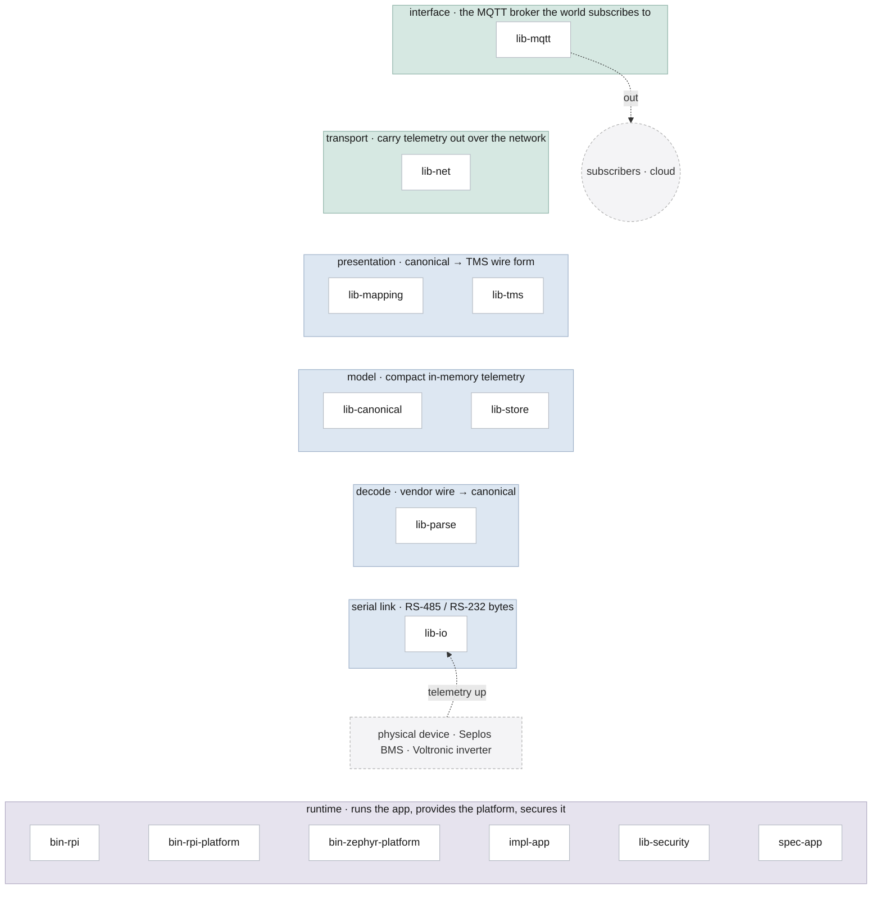

# sentient-rs

Production Rust telemetry adapter for the Sentient METEOR TPM/TEM: poll a Seplos BMS over RS-485,
map to TMS (MIL-STD-3071), and publish over MQTT. Runs on a Raspberry Pi comms module (the paid
deliverable) with a Zephyr MCU forward path. The protocol/mapping core is platform-free and
`no_std` (builds for `thumbv7em-none-eabihf`); platform lives behind traits + feature flags.

## Architecture

The workspace reads as a **runtime data-flow stack** — telemetry rises from the physical device
at the bottom, up through decode → model → mapping, and out the top via the MQTT interface +
network; a **runtime** base runs the app, provides the platform I/O, and secures it. Bands group
into three zones (egress · data · runtime).

<!-- ANCHOR: dataflow -->

<!-- ANCHOR_END: dataflow -->

This is the *runtime* view (how data moves). The complementary *compile-time* view — the acyclic
crate **dependency** layering that `cargo-deny` bans + the roster/orphan gate
([`.ci/crate-graph.toml`](.ci/crate-graph.toml)) enforce, including the `Platform` contract seam
(`spec-app`) that keeps the `impl-app` policy hardware-free
([ADR 0009](docs/decisions/0009-spec-app-ports-and-adapters.md)) — is the detailed dependency
graph in [`crates.svg`](docs/architecture/crates.svg). Regenerate both with `just depgraph`.

## Crates

| Layer | Crate | Responsibility |
|---|---|---|
| foundation | `lib-canonical` | Vendor-neutral canonical device model (`CanonicalReading`/`CanonicalFault` + inverter). Pure, `no_std`. |
| | `lib-tms` | Generated MIL-STD-3071 (TMS) wire model, emitted from the IDL. Pure, `no_std`. |
| | `lib-security` | Auth/cert/crypto behind a provider seam (FIPS + TrustZone toggles; wolfCrypt backend). |
| | `lib-store` | Bounded in-memory canonical telemetry store — the render-on-output memory model. Pure, `no_std`. |
| domain | `lib-parse` | Vendor protocol parsers (Seplos BMS, Voltronic inverter) → the canonical model. Pure, `no_std`. |
| | `lib-io` | `SerialTransport` async trait (generic, no `dyn`) + host tokio-serial / embassy MCU UART + generic poll driver + JSONL persist. |
| bridge | `lib-mapping` | The sole canonical↔TMS boundary: transform + generated wire encoders + the `Publisher` contract + legacy. |
| contract | `spec-app` | The app contract (ADR 0009): the `Platform` port + `RunConfig`/`Health` + preflight — the seam binaries inject through. |
| service | `lib-mqtt` | Embedded rumqttd MQTT server + `Publisher` over its in-process link (RPi side). |
| | `lib-net` | The device network layer: the owned MCU stack (channel/link/embassy) + host mesh-radio + location, feature-gated per target. |
| app | `impl-app` | The pure `run` loop (poll → decode → TMS → publish), generic over `spec_app::Platform`. Hardware-free. |
| platform | `bin-rpi-platform` | RPi platform adapter — `HostPlatform` (embedded broker + mesh/locate) implementing `spec_app::Platform`. |
| | `bin-zephyr-platform` | Zephyr MCU platform adapter — FFI + `ZephyrPlatform`, at `bin/zephyr/platform/`; a workspace member. |
| bin | `bin-rpi` | The Raspberry Pi Linux binary (the deliverable) — composition root that injects `bin-rpi-platform`. |
| | `bin-zephyr` | Zephyr `west` app (forward path): `rust_main` + the C shim; built via `west`, not `cargo`. |

Test crates (`test-kit`, `test-e2e`, `test-acceptance`) provide the shared sims/harness, live
end-to-end tests, and the Cucumber acceptance suite.

## Documentation

- [`docs/README.md`](docs/README.md) — full documentation index (guides + per-crate module reference).
- [`docs/deployment/README.md`](docs/deployment/README.md) — RPi install, wiring, config, mosquitto relay, systemd, runbook.
- [`docs/security/README.md`](docs/security/README.md) — security posture, boot integrity, TPM recommendations (Scope E).
- [`docs/security/signing-and-verification.md`](docs/security/signing-and-verification.md) — cosign keyless release provenance + X.509 CMS on-device binary verification, end to end.
- [`docs/compliance/README.md`](docs/compliance/README.md) — schema-shape compliance vs MIL-STD-3071.

## Build & test

```sh
cargo test --workspace
cargo clippy --workspace --all-targets -- -D warnings
# no_std core for the MCU forward path:
cargo build -p lib-parse -p lib-mapping -p lib-io -p impl-app \
  --no-default-features --target thumbv7em-none-eabihf
```

The Zephyr app builds via `west` (see `bin/zephyr/README.md`), never `cargo build` directly.
