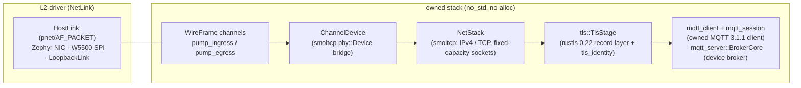
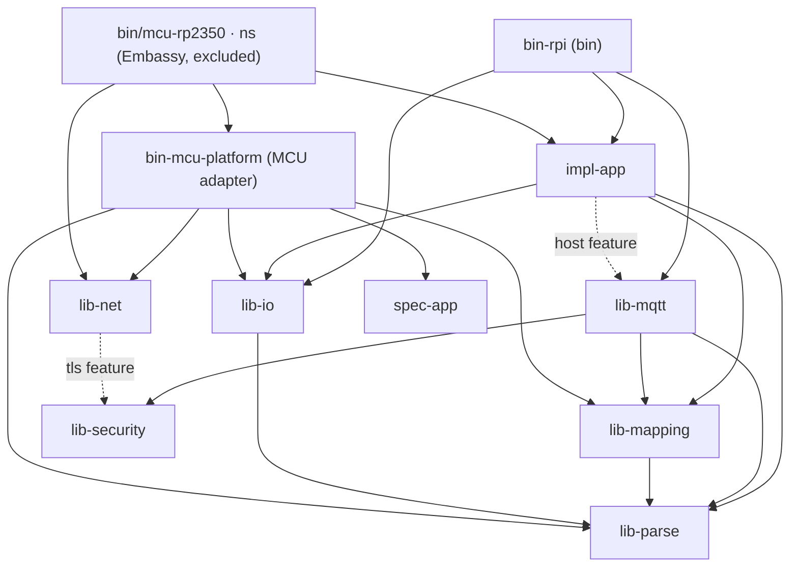

Architecture · System Design

# Architecture

How `sentient-rs` turns Seplos BMS telemetry into TMS-compliant MQTT, and how one codebase targets
both a Raspberry Pi (Linux/tokio, shipped as a minimal **Yocto Linux** image — Pi 4-64 and Pi 5) and
an RP2350 (Cortex-M33) MCU (`no_std`/**Embassy**). This doc is the end-to-end map; per-crate detail is
in the [API reference](./reference/README.md), on-device operation in
[`deployment.md`](./deployment/README.md), and security depth in [`security.md`](./security/README.md).
The MCU runtime pivot (Zephyr → Embassy) and its
S/NS security boundary are recorded in ADRs [0010](./decisions/0010-mcu-runtime-embassy.md) and
[0011](./decisions/0011-mcu-security-boundary.md) (the latter carries the RP2350 memory-layout
diagram).

## 1. The data pipeline

The system polls a Seplos BMS over an RS-485 serial bus, decodes each frame to a vendor-neutral
model, maps that to the TMS (MIL-STD-3071) data model, and publishes the typed payloads over MQTT.

```mermaid
flowchart LR
  BMS["Seplos BMS v2<br/>(RS-485, 19200 8N1)"]
  T["lib-io<br/>SerialTransport + driver"]
  P["lib-parse<br/>Seplos codec → CanonicalReading/Fault"]
  M["lib-mapping<br/>transform → TMS schema → no_std JSON"]
  PUB["Publisher sink<br/>(lib-mapping::sink)"]
  BRK["lib-mqtt<br/>embedded rumqttd broker"]
  MOS["mosquitto bridge (external)<br/>TLS → private cloud / Greengrass"]

  BMS -->|bytes| T -->|response frame| P -->|canonical| M -->|TMS JSON| PUB -->|publish| BRK -->|subscribe tms/#| MOS
```

The loop that drives this lives in `impl-app`: `run` owns cadence, exponential `Backoff`
(1 s → 30 s on dead cycles), the health/watchdog hook, and the periodic summary; `run_cycle` does
one cycle (telemetry per DIP address, faults on the `fault_every` cadence, publish each mapped
payload) and records outcomes into `Health`. `Health::healthy()` is the signal the RPi platform
gates the systemd watchdog on. See `impl-app` in the [API reference](./reference/README.md) and the
operational view in [`deployment.md`](./deployment/README.md) §7–§8.

The `TMS JSON` step is not `serde` on the MCU. Because the device *hosts* the broker on 64 KB SRAM
and the broker thread renders payloads on demand, `serde-json-core`'s recursive serialization (deep
per-field frames down to a `ryu` float leaf, plus a materialized TMS struct) overran the broker
stack. The MCU instead uses a bespoke **flat, integer-formatting serializer** — canonical scaled
integers formatted with a positional decimal (no `serde`, `ryu`, or `f32`), JSON structure held as
`&'static str` in flash, and a shared count/emit traversal that yields the MQTT length in one pass.
Design and full rationale: [`wire-serialization.md`](./architecture/wire-serialization.md).

Correctness is measured against the Seplos protocol + real device captures + the TMS standard, never
the Python prototype (see `KICKOFF.md` at the repo root).

## 2. Dual-target design via trait seams

The paid deliverable is the RPi Linux binary, shipped as a minimal **Yocto Linux** image
(`core-image-minimal` + systemd, Pi 4-64 and Pi 5); the RP2350 MCU is the second target. The
protocol/mapping core is platform-free and `no_std`, and the platform-specific pieces sit behind
traits, so the RPi↔MCU split is an implementation swap, not a rewrite. (The Pi ran Linux/tokio all
along; the earlier "Zephyr on both targets" plan was reversed 2026-07-12 once it was clear Zephyr has
no Ethernet L2 driver for the Pi 5 — running Linux dissolves that blocker. See story #159. The MCU
itself later pivoted Zephyr → Embassy — ADR [0010](./decisions/0010-mcu-runtime-embassy.md).)

| Concern | RPi (`host` feature) | RP2350 MCU (Embassy, `bin-mcu-platform`) |
|---|---|---|
| Core (Seplos parse, TMS map, codec, publish contract) | shared, `no_std` | **identical, shared** |
| Executor | tokio | `embassy-rp` (Cortex-M33, `thumbv8m`; async preserved) |
| Serial transport | `tokio-serial` (`HostSerial`) | `EmbassyUart` (`embassy-rp` UART) — same `SerialTransport` trait |
| MQTT | **hosts** an embedded rumqttd broker | **hosts** a device-local broker over the W5500 (device-hosted) — same `Publisher` trait |
| alloc | std heap | no global allocator; core is heapless/no-alloc regardless |

The three seams that make this work:

- **`SerialTransport`** (`lib-io`) — the async byte-transport trait, used **generically**
  (`<R: SerialTransport>`, static dispatch, no `Box<dyn>`), so the generic driver monomorphizes onto
  a host `tokio-serial` port or an embassy MCU UART.
- **`Platform`** (`spec-app`, ADR 0009 — the app contract, re-exported by `impl-app` for path
  stability) — the per-target factory: `transport()`, `publisher()`, `now()`, `sleep()`,
  `on_cycle()`, `reconnect()`. Each entry point builds the concrete platform (`bin-rpi` via
  `bin_rpi_platform::HostPlatform`, the MCU via `bin_mcu_platform::McuPlatform`) and hands it to
  `run`. Both adapters depend down onto `spec-app` (not `impl-app`) per ADR 0009. Only one platform
  ever links into a given binary.
- **`Publisher`** (`lib-mapping::sink`) — the `no_std` publish contract, implemented by the RPi
  broker (`BrokerPublisher`, publish onto the local broker) and the MCU's `ChannelPublisher`
  (deferred publish onto the device-hosted broker pump via a `lib-net` channel). The
  broker-host-vs-client difference is behind the trait, not in it.

The MCU adapter is `bin-mcu-platform` (an `no_std`, host-clippy-able workspace crate, the symmetric
peer of `bin-rpi-platform`); the concrete Embassy binary is `bin/mcu-rp2350` — **excluded from the
cargo workspace**, with its own `Cargo.lock` and pins (`embassy-rp 0.10` `rp235xa`), built with
`cargo build --target thumbv8m.main-none-eabihf` (never `cargo build --workspace`), modelled on the
proven `hil/pico-seplos-emu` template. See ADRs
[0010](./decisions/0010-mcu-runtime-embassy.md) (runtime) and
[0011](./decisions/0011-mcu-security-boundary.md) (S/NS boundary + memory layout).

## 3. Security seam

Cryptography, key custody, auth tokens, and certificate verification live behind one provider seam
in `lib-security`, with two posture toggles honored **by construction**:

- **FIPS × TrustZone tiers** — `SecurityProfile` resolves the compile-time `fips` / `trustzone`
  features into a runtime-readable tier (`tier_slug()` e.g. `fips+trustzone`, `standard+software`;
  `custody_warning()` at boot for the software tier). Turning a toggle off is never silently
  equivalent to turning it on.
- **Opaque `KeyStore`** — a private key is a `KeyHandle`, never bytes; signing happens *at* the
  store, and there is deliberately no `export_private`, so the type system forbids leaking key
  material. `KeyStore::custody()` forces a software store to admit `SoftwareMemory` custody.
- **Fail closed** — every verify returns `Result`; unbound backends return `NotImplemented`, never a
  fake success. The FIPS approved-algorithm gate (`Provider::check_approved`) refuses non-approved
  primitives (Ed25519 is the one listed non-approved algorithm).
- **wolfCrypt backend** — the concrete backend (feature `wolfcrypt`, a separate build ledger needing
  system wolfSSL).

The crypto operations are currently fail-closed stubs; the seam defines and tests the boundary. For
depth see [`security.md`](./security/README.md) (posture, boot integrity, TPM),
[`security-integration-map.md`](./security/integration-map.md) (where each integration point plugs
in), [`wolfcrypt-backend.md`](./security/wolfcrypt-backend.md), and
`lib-security` in the [API reference](./reference/README.md).

## 4. Owned network stack (built; MCU-only, on-device hardware wiring pending)

Two crates — `lib-channel` and `lib-link` — build an **owned** network path that owns everything
above L2 (IP, TCP, TLS, MQTT), `no_std`. **Since the 2026-07-12 platform pivot this is an MCU-only
path:** the Pi ships Yocto Linux and uses the mainline kernel's TCP/IP stack via tokio/`std::net`
(the `bcmgenet`/RP1 driver owns L2), so the owned stack is no longer needed there. On the MCU (which
has no OS network stack) it is the forward path for a self-owned MQTT-over-TLS client over the
board's Ethernet/SPI-NIC L2.

> **Status.** The stack is **built and tested**, not a design sketch. `lib-channel` (the boundary
> messages + channel/stage contracts) and `lib-link` (the `NetLink` driver seam, a **folded smoltcp**
> `NetStack` over `ChannelDevice`, a TLS record-layer stage over rustls 0.22 (`tls::TlsStage`, feature
> `tls`) with a `KeyStore`-backed server-identity seam (`tls_identity`), and an owned MQTT 3.1.1
> client + connection-flow session state machine (`mqtt_client`, `mqtt_session`) alongside a
> caller-driven broker core (`mqtt_server::BrokerCore`)) all exist, build for the MCU target (`just
> build-no-std`), and are tested end-to-end in `crates/test-e2e/tests/{tls_stage,owned_mqtt,
> owned_broker_e2e}.rs` — including a genuine TLS handshake + encrypted PUBLISH against a real
> `rumqttd` broker (`owned_mqtt.rs`). **`lib-net`'s embassy path is now consumed.** The
> device-hosted broker pump + channel halves + `LatestStore` under `crates/lib-net/src/embassy/` —
> the "consumed by no crate" spike at the time this section was first written — are now linked by the
> shipping MCU binary `bin/mcu-rp2350/ns` (via `bin-mcu-platform`), replacing the retired Zephyr broker
> pump. On the Pi the production path remains the embedded rumqttd broker +
> external mosquitto bridge described in [`deployment.md`](./deployment/README.md) — the owned stack is not
> part of the RPi shipping graph. The honest remaining gap is **on-device validation on real MCU
> hardware**: the stack is proven on host tests (there is **no RP2350 emulator** — ADR
> [0010](./decisions/0010-mcu-runtime-embassy.md)), not yet run against physical Ethernet/SPI-NIC
> silicon; HIL smoke on the bench Pico 2 is queued.
>
> There is no committed `HANDOFF.md` / network-pipeline handoff document at the current `main`; the
> design below is derived from the `lib-channel` / `lib-link` source and their module docs
> plus `KICKOFF.md` at the repo root.

The four boundary messages in `lib-channel` model the pipeline as a chain of
independently-hardenable stages: `UartChunk` (serial), `MqttUnit` (dissemination), `CryptoUnit` (the
crypto handoff — data + an *opaque* key context, never key bytes, keeping keys behind the
`lib-security` boundary), and `WireFrame` (raw L2). Each boundary is bounded (`heapless`) and,
under `feature = "packed"`, packed-byte (postcard) serializable — so a stage can run as its own task
or isolated process, and the exact bytes at each boundary are capture-vector-testable.

## 5. Crate dependency graph

Workspace-internal dependency edges (derived from each `[dependencies]` in `Cargo.toml`; the arrow
points from a crate to what it depends on):

> The MCU adapter `bin-mcu-platform` depends **down onto `spec-app`** (the contract), not `impl-app`
> — the dependency-inversion consequence of ADR [0009](./decisions/0009-spec-app-ports-and-adapters.md);
> the thin `bin/mcu-rp2350` binary is the composition root that pulls in both `impl-app` (to `run`) and
> the adapter (to `build`). The former `lib-channel`/`lib-link` crates shown in earlier revisions
> were folded into `lib-net` (#287); the authoritative, generated edge list lives in
> [`architecture/crate-graph.md`](./architecture/crate-graph.md).

As a table:

| Crate | Depends on (workspace) | Depended on by (workspace) |
|---|---|---|
| `lib-parse` | — | `lib-mapping`, `lib-io`, `lib-mqtt`, `impl-app`, `bin-mcu-platform` |
| `lib-mapping` | `lib-parse` | `lib-mqtt`, `impl-app`, `bin-mcu-platform` |
| `lib-io` | `lib-parse` | `impl-app`, `bin-rpi`, `bin-mcu-platform` |
| `lib-mqtt` | `lib-parse`, `lib-mapping`, `lib-security` | `impl-app` (host, optional), `bin-rpi` |
| `impl-app` | `lib-parse`, `lib-mapping`, `lib-io`, `lib-mqtt` (optional, host) | `bin-rpi`, `bin/mcu-rp2350` (`ns`) |
| `spec-app` | (trait/data crates only) | `impl-app`, `bin-rpi-platform`, `bin-mcu-platform`, `bin/mcu-rp2350` (ADR 0009) |
| `bin-rpi` | `impl-app`, `lib-io`, `lib-mqtt` | — (binary) |
| `lib-security` | — | `lib-mqtt`, `lib-net` (optional, tls/crypto) |
| `lib-net` | `lib-security` (optional, tls/crypto) | `bin-mcu-platform`, `bin-rpi-platform` (host), `bin/mcu-rp2350` — folds the former `lib-channel`/`lib-link`/embassy spike (#287) |
| `bin-mcu-platform` | `spec-app`, `lib-io`, `lib-mapping`, `lib-parse`, `lib-net` | `bin/mcu-rp2350` (the Embassy MCU binary) |
| `bin/mcu-rp2350` (`ns`) | `bin-mcu-platform`, `spec-app`, `impl-app`, `lib-io`, `lib-net` (Embassy, excluded from the workspace; own `Cargo.lock`) | — (MCU app) |

Notes: `lib-security` **is** consumed by the shipping RPi binary — `bin-rpi` → `lib-mqtt` →
`lib-security` for the broker's CONNECT authorization (`TokenVerifier`, `crates/lib-mqtt/src/broker/`);
the crypto operations behind the provider seam are still fail-closed stubs pending a production
backend (see §3), but the dependency edge itself is real, not aspirational — track the backend work
against [`security-integration-map.md`](./security/integration-map.md). The owned network stack
(now consolidated into `lib-net`, #287 — formerly `lib-channel`/`lib-link` + the embassy spike) is
**not** on the RPi's shipping graph — its embassy path is consumed by the MCU binary `bin/mcu-rp2350`
(via `bin-mcu-platform`), where it **is** wired into the device-hosted broker pump
(`crates/lib-net/src/embassy/`), replacing the retired Zephyr broker pump; see §4 for the
owned-stack status. Some
cross-crate relationships are dev-only (e.g. `lib-mqtt` and `impl-app` reference each other's test
surfaces via dev-dependencies) and are omitted from the graph above, which shows normal
`[dependencies]` edges only.

## 6. Delight-features seams (mesh, power telemetry, on-device UI)

Four additional seams landed on top of the §2 design, beyond the original contracted scope (added
for customer delight at handover). Full rationale — the board move that enabled them, the crates
evaluated and rejected along the way, and the explicit claims/non-claims — is recorded in
[ADR 0012](./decisions/0012-delight-features-scope-and-seams.md); this section is the map, not the
argument.

- **The board move.** The MCU target moved from a Pico 2 to an **Adafruit RP2350 Feather** (8 MB
  flash, 520 KB SRAM) so an OLED FeatherWing and an INA3221 breakout can stack natively on the
  Feather's STEMMA QT / FeatherWing header, sharing one I2C1 bus (SDA=GP2, SCL=GP3) with no extra
  GPIO. See ADR [0010](./decisions/0010-mcu-runtime-embassy.md)'s runtime pivot for the
  Zephyr→Embassy context this move sits on top of.
- **Meshtastic mesh sender** (`crates/lib-net::mesh`, `no_std`/no-alloc) — condenses a
  `CanonicalReading` (+ optional `CanonicalFault`, + optional location) into a bounded on-air
  Meshtastic protobuf frame over a serial `SerialTransport`. **Both targets ride the same codec**:
  the Pi's tokio `run_radio` loop and the MCU's mesh sender (`bin-mcu-platform`) call the identical
  buffer-based encoder — a divergent std copy of a codec just rewritten to be shared would be
  strictly worse. See ADR [0006](./decisions/0006-meshtastic-protobuf-approach.md) (superseded) for
  why this is hand-rolled rather than a `prost`/`meshtastic`-crate dependency.
- **`RailMonitor`** (`spec-app`, a default-no-op sibling of the existing `emit_inverter_reading`
  hook on `Platform`, via `Platform::emit_rail_draw`) — a multi-channel `read_all` seam backed by an
  **owned async INA3221 driver** (`crates/lib-io/src/ina3221/`, feature `ina3221`) measuring the
  W5500 and Heltec rails on the shared I2C1 bus. **This is the adapter board's OWN power draw —
  engineering self-telemetry for diagnostics + the on-device UI, NOT the project's power
  telemetry.** The project's power source is the Seplos BMS (pack voltage/current/SOC), mapped to
  TMS in `lib_mapping::transform`. An earlier wave wrongly mapped the INA3221 readings onto
  `DcMeasurementUpdate.internal_measurement` — the same TMS mission topic the pack uses; that
  mapping was removed (see ADR [0012](./decisions/0012-delight-features-scope-and-seams.md)).
  `bin-mcu-platform`'s `emit_rail_draw` override now publishes a small, non-TMS diagnostic JSON
  payload (`{"eth_ma":…,"radio_ma":…}`) to a fixed `diag/rails` topic instead, and
  `Ina3221RailMonitor` (a local newtype wrapper in `bin-mcu-platform`, needed to satisfy Rust's
  orphan rule) implements `RailMonitor` for the driver. The driver itself is owned rather than
  dependency-pulled because the `ina3221` crate (0.4.5, 2023-02-20) is pinned to a pre-1.0
  `embedded-hal` alpha that cannot compose with `embedded-hal 1.0`/embassy — the same trap the OLED
  research flagged for `sh1107`.
- **`DrawTarget`** (`embedded-graphics` 0.8.2) — the on-device UI's render seam. Four screens
  (`crates/bin/mcu-rp2350/ns/src/ui/`, feature `ui`) render against `DrawTarget<Color = BinaryColor>`
  generically, so the MCU's SSD1306-backed OLED FeatherWing and a host `MockDisplay` are both valid
  targets — CI exercises all four screens pixel-exact with no hardware and no SDL. A hand-rolled
  `enum Screen` + render trait was chosen over any GUI-toolkit crate (`embedded-gui` rejected: 66
  downloads, single author, ~7 weeks old, and the like-named GitHub project is abandoned and
  self-describes as "(bad)"); `slint`/`lvgl` were rejected for requiring a global allocator this
  `no_std` MCU target doesn't have.

These four seams are additive to the §2 table — they extend `Platform` and add new trait objects
rather than changing the existing `SerialTransport`/`Publisher` contracts, so `bin-rpi-platform`
compiles and behaves unchanged.
