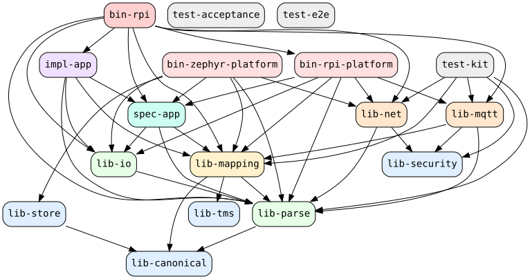

<p class="eyebrow">Architecture · Compile-Time View</p>

# Crate dependency graph

The [introduction](../introduction.md) shows the *runtime* view — how telemetry moves through
the stack; this chapter is the complementary *compile-time* view — the acyclic crate
**dependency** layering that the `cargo-deny` bans and the roster/orphan gate
(`.ci/crate-graph.toml`) enforce, including the `Platform` contract seam (`spec-app`) that
keeps the `impl-app` policy hardware-free
([ADR 0009](../decisions/0009-spec-app-ports-and-adapters.md)).

## Full dependency graph

Every workspace crate and every allowed edge, as enforced in CI:



## Layered band view

The same roster grouped into its architectural bands (generated alongside the graph above):

```mermaid
{{#include crates.mmd}}
```

Both diagrams are **generated** — regenerate them with `just depgraph` after any change to the
workspace membership or an inter-crate dependency.
