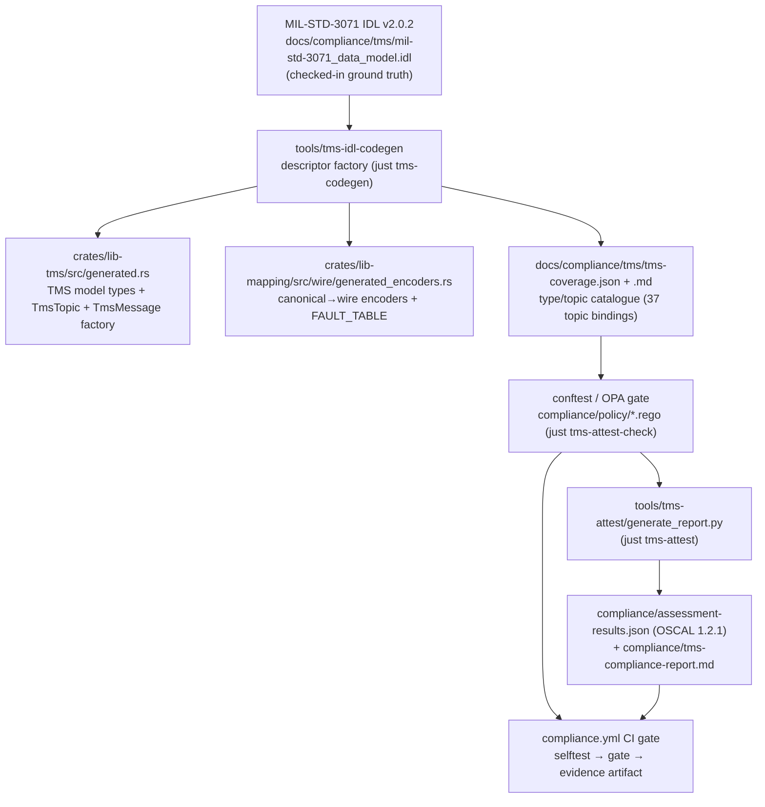

Sentient METEOR · TMS Compliance · Attestation Pipeline

# Attestation pipeline (OSCAL · policy · evidence)

TMS conformance is not asserted by hand — it is **generated, machine-checked, and re-emitted as
evidence** on every relevant change. One chain runs from the checked-in MIL-STD-3071 IDL to an
OSCAL assessment-results document, with a conftest/Rego gate in the middle deciding red/green
in CI:

> **What the gate proves — and what it does not.** This gate checks **IDL type-catalogue
> coverage**: for every topic MIL-STD-3071 classifies as Required or Conditional, a shaped Rust
> type with a parsed `@topic` binding exists in the generated catalogue. It does **not** check
> **runtime publish-wiring** — whether `bin-rpi` actually publishes or subscribes that topic at
> runtime. A topic can pass this gate while never being published. The runtime-wiring axis is
> tracked separately (and today manually) in [TMS compliance: field-by-field](README.md)
> and in `compliance/oscal/component-definition.json`'s `bin-rpi` component-implementation
> statuses. Never read this gate's green as "the device emits everything".

## Ground truth: the IDL, and what "compliance" can mean here

The single source of truth is the checked-in MIL-STD-3071 TMS Data Model IDL **v2.0.2**
(`docs/compliance/tms/mil-std-3071_data_model.idl`, alongside the standard's PDF). Every
generated type carries provenance back to a specific IDL line.

MIL-STD-3071 §1.5 states plainly: *"This document does not define test procedures that verify
compliance with this standard."* No attestation or report format is prescribed anywhere in the
standard — so this pipeline's catalog, policies, and report shape are a **project-defined
conformance framework**, not a certified DDS conformance test. The framework's spine is the
A.8.7 topic × usage × condition matrix (Tables B.1/B.2) plus the D.4/D.5 conformance
categories, and it is honest about its documented adaptations:

| Adaptation | Detail |
|---|---|
| Transport | MQTT+JSON, not DDS/XCDR2/RTPS — the IDL is used as the schema-shape oracle only |
| JSON key casing | snake_case wire keys vs. IDL camelCase — spec-silent (the real DDS wire is positional binary; there is no "spec casing" for JSON to violate) |
| Topic naming | `tms/{device_id}/{snake_slug}` vs. the IDL's bare CamelCase names — a documented, reversible bridge rule |
| Sequence bounds | some `heapless` bounds narrowed below IDL `MAXLEN` for the MCU's 64 KB SRAM budget — emit-safe, decode-side-truncating, documented per type |

## Stage 1 — the descriptor factory (`tools/tms-idl-codegen`)

The codegen tool is its **own Cargo workspace** under `tools/`, so its parser/quote/prettyplease
dependencies never enter the firmware dependency graph or the cargo-vet surface. `just
tms-codegen` (the `emit` subcommand) parses the IDL and writes four files:

| Output | Content |
|---|---|
| `crates/lib-tms/src/generated.rs` | The pure TMS model — types, IDL typedefs, `TmsTopic`/`TmsTopicId`, and the `TmsMessage` decode factory |
| `crates/lib-mapping/src/wire/generated_encoders.rs` | The bridge — flat canonical→wire encoders and `FAULT_TABLE` |
| `docs/compliance/tms/tms-coverage.json` | The machine-readable type/topic catalogue: per type, its module, `idl_line` provenance, `topics` bindings, and field/key/unit/range counts |
| `docs/compliance/tms/tms-coverage.md` | The [human traceability report](tms/tms-coverage.md) — currently 103 structs, 33 enums, **37 topic bindings** |

Freshness and correctness are separately gated:

| Recipe | Guarantee |
|---|---|
| `just tms-codegen` | regenerate all four outputs from the IDL |
| `just tms-codegen-check` | CI-fails if a committed generated file is stale vs. a fresh in-memory regeneration |
| `just tms-codegen-test` | the codegen tool's own parser/resolver unit tests (out of workspace) |
| `just test` (workspace) | byte-identity proofs: frozen-spelling tests in `crates/lib-tms/tests`, wire-encoder proofs in `crates/lib-mapping/tests` |

## Stage 2 — the policy gate (conftest / Rego)

`just tms-attest-check` is the actual pass/fail gate: `conftest test --policy
compliance/policy --data compliance/policy/data docs/compliance/tms/tms-coverage.json`. Three
policies, one hand-curated data file:

| Policy | Check |
|---|---|
| `topic_coverage.rego` | Every topic MIL-STD-3071 classifies as **Required** (8 topics) or **Conditional** on one of the 10 named A.8.7 conditions (11 topics) has a type binding in the catalogue — i.e. the factory actually parsed an IDL `@topic` annotation for it. "Absent" is defined as *no type carries this topic name*, since the catalogue has no implemented/absent boolean. |
| `provenance.rego` | Every topic-bound type traces to a real, positive `idl_line` in the checked-in IDL. A topic type with no traceable line could be a hand invention — exactly the class of bug issue #257's invented `Request` topic was. |
| `catalog_integrity.rego` | Regression guards on the catalogue's own shape: total topic bindings must not fall below the Table B.2 baseline (`min_topic_bindings` = 37 as of the 2.0.2 IDL), and no duplicate `(module, name)` pairs. Catches the factory silently *losing* coverage it used to have. |

The data file, `compliance/policy/data/tms_topic_classes.json`, is the deliberate
**hand-curated cross-reference**: which topic names Table B.2 / A.8.7 classify as Required or
Conditional (with each condition named, e.g. `DcLoadSharingState` ⇐ "HAS DC PORTS"). The
coverage JSON itself carries no usage-class field — this file is what lets the policies assert
against the real Table B.2 rather than a guess.

**The policies are themselves regression-tested.** `just tms-policy-selftest` runs conftest
against a known-broken fixture (`compliance/policy/testdata/tms-coverage-broken-example.json`)
and *inverts* the result: green means "the policies correctly denied the injected breakage". A
Rego bug that silently stopped denying would otherwise go unnoticed, since the real coverage
file is currently green.

## Stage 3 — the attestation generator (`tools/tms-attest`)

`just tms-attest` runs `tools/tms-attest/generate_report.py` — a deliberately **stdlib-only
Python script**, outside the Cargo workspace, so it never touches the Rust dependency graph. It
re-runs conftest (JSON output), joins the verdict with the topic-class cross-reference, and
emits two evidence documents:

| Output | Shape |
|---|---|
| `compliance/assessment-results.json` | **OSCAL 1.2.1 assessment-results**: one observation per Required/Conditional topic control (`tms-topic-*`), findings for any unbound topic, the full conftest deny/warn output as a meta-observation, and a `gate-verdict` PASS/FAIL prop. Its `import-ap` references `oscal/catalog.json` directly — no separate assessment-plan document is authored; the Rego policies *are* the plan-equivalent. |
| `compliance/tms-compliance-report.md` | The human report: conformance stance, documented adaptations, Required/Conditional coverage tables with per-topic type + IDL line, conftest findings, and the known-gap section. |

The script's exit code mirrors conftest's verdict, but the `just tms-attest` recipe is
non-fatal by design (`|| true`) — the report is written either way so a failing PR shows
*what* is missing; `just tms-attest-check` is the recipe that actually gates.

## The OSCAL documents

| File | Role |
|---|---|
| `compliance/oscal/catalog.json` | **Custom (non-NIST) OSCAL catalog**, control groups `required-topics` / `conditional-topics` / `cross-cutting`, derived from A.8.7 and Tables B.1/B.2 plus D.4 (IDL annotations), D.5 (QoS), and A.8.6 (topic naming). |
| `compliance/oscal/component-definition.json` | Maps sentient-rs components — the `tms-idl-codegen` descriptor factory, the `bin-rpi` runtime, the TMS wire types, the `lib-mapping` transform — onto the catalog's controls, each with an `implementation-status` of `implemented` / `partial` / `planned` / `alternative-implementation` / `not-applicable`. This is where the **runtime publish-wiring** axis lives. |
| `compliance/assessment-results.json` | Generated (stage 3) — never hand-edited. |

Two tooling decisions are deliberate:

- **trestle is an authoring aid only.** not in CI
  compass-trestle is used to re-author/validate `compliance/oscal/*.json` by hand and is
  deliberately *not* installed in CI — the gate needs only conftest and stdlib Python.
- **Lula is deliberately absent.** Lula 1 is vendor-abandoned; nothing depends on it. The
  component-definition's `conftest-policy` link rel is this project's own convention for
  "which Rego policy machine-checks this requirement", playing the role Lula's validation
  links played without depending on Lula's schema.

## The CI gate — `compliance.yml`

The workflow is **entirely independent of the Rust build**: no cargo, no builder container — a
plain `ubuntu-latest` runner with two pinned, sha256-verified prebuilt binaries (per the house
"never source-compile CI tools" convention):

| Tool | Pin |
|---|---|
| `just` | 1.56.0, curl + sha256 verify |
| `conftest` | 0.68.2, curl + sha256 verify |

It runs on PRs touching `docs/compliance/tms/**`, `compliance/**`, `tools/tms-attest/**`, the
`justfile`, or itself, in a fixed ladder:

1. `just tms-policy-selftest` — prove the policies still deny on the broken fixture *before*
   trusting their verdict;
2. `just tms-attest-check` — **the gate**; conftest's own exit code decides red/green;
3. `just tms-attest` (`if: always()`) — evidence even on a red gate, so the PR shows exactly
   which topic or integrity check failed;
4. upload the `tms-compliance-evidence` artifact (assessment-results + report) and a step
   summary that restates the coverage-vs-wiring distinction.

## Known gap: the runtime-wiring axis

As recorded in the committed report (`compliance/tms-compliance-report.md`): the four
Required / de-facto-Required STOR topics — `ActiveMicrogridControllerState`,
`EnergyStartStopState`, `PowerPortState`, `DcLoadSharingState` — **are now wired at runtime**
by the spec-conformance sweep (per-identity `state_publisher` task + the A.7.5 MC-selection
state machine in `crates/bin/rpi/src/tasks/`; issues #263/#264/#265 closed, with PROVISIONAL
content where a telemetry-only device cannot source a field). Seven Conditional topics remain
type-bound but have **no runtime publisher** (condition-dependent, not Required for our STOR
role): `AcLoadSharingState`, `AcSummaryMeasurementUpdate`, `ControlParameterState`,
`IdentityNicknameState`, `OperatorIntentState`, `GroundingCircuitState`,
`AuthorizationToEnergizeReply`. The type-catalogue gate is green for all of them; their
runtime status lives in the component-definition, manual
axis not yet machine-checked.
