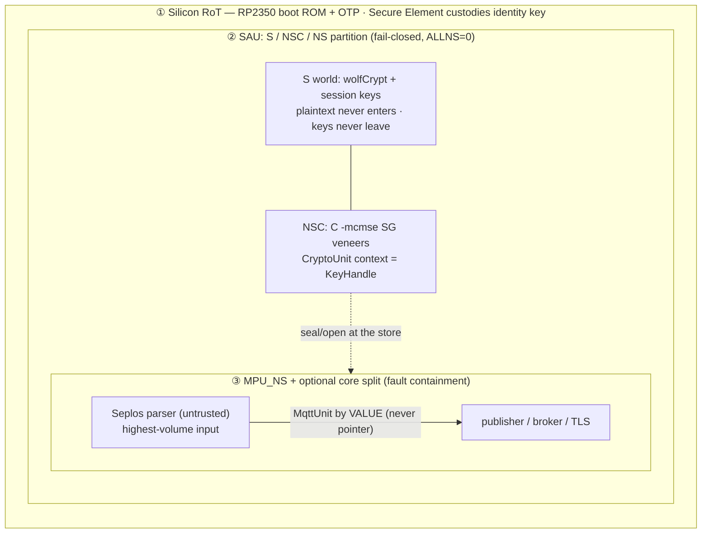
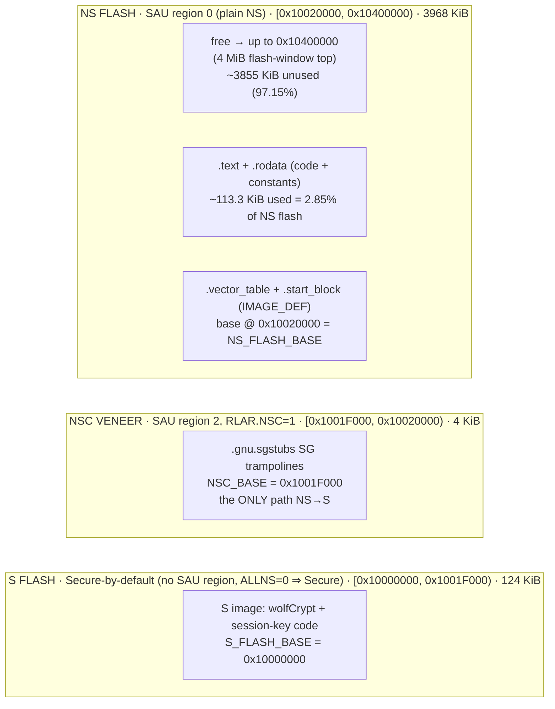
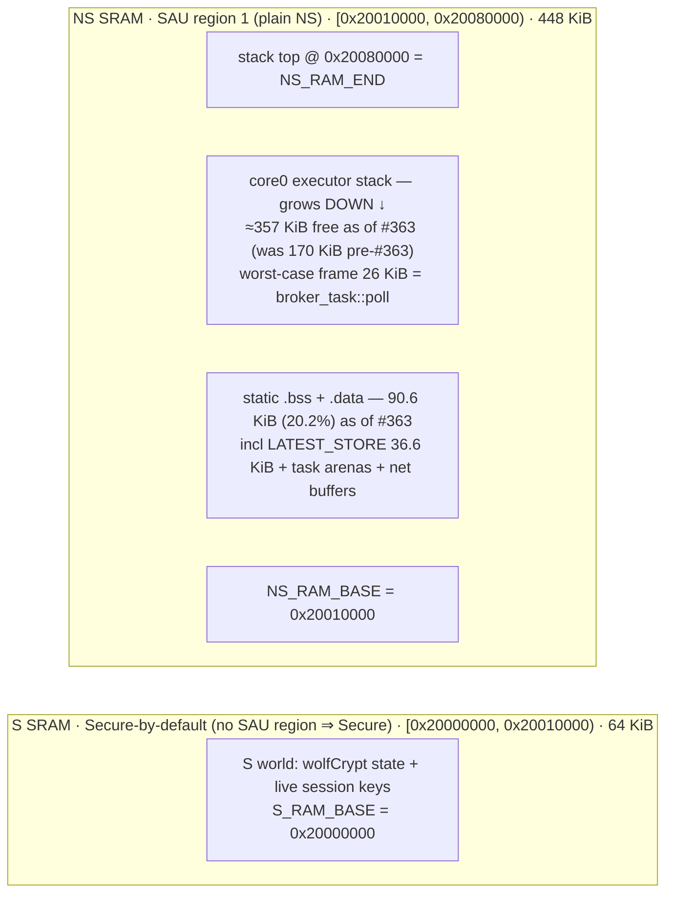

# 0011 — MCU security boundary: three concentric boundaries on RP2350 (demo scaffold)

**Status:** Accepted (2026-07-24) — EPIC #350, story S6 (#357). **Demo scaffold, not production.**

## Context

The MCU (RP2350, Cortex-M33) is the `no_std` half of the product. Its security architecture was
locked in a dedicated review whose decisions this ADR records. The runtime that hosts it is
Embassy (ADR [0010](./0010-mcu-runtime-embassy.md)); this ADR is about **where the trust boundaries
sit** and, concretely, **how the address space is partitioned** to place them.

The design is deliberately layered so that a compromise at one layer is bounded by the next. It is
a **demo scaffold on RP2350 A4 stepping only** — the claims and, just as importantly, the explicit
**non-claims** are stated below rather than left to assumption (per the `CLAUDE.md` "don't invent
tool facts" doctrine).

## Decision

Three **concentric** boundaries, from outermost (silicon) to innermost (task isolation):



### ① Silicon Root of Trust — the SE *hardens* the key, it does **not** anchor the chain

The RP2350 boot ROM + OTP verifies the bootloader (Gate-0-deferred — see ADR
[0010](./0010-mcu-runtime-embassy.md)). A **secure element** custodies the device **identity key**.

The key distinction, called out because it is easy to get backwards: **the SE hardens the identity
key (tamper-resistant custody, key never leaves the SE); it does NOT anchor the trust chain.**
Something *immutable on the die* (the boot ROM + OTP) must verify the bootloader that eventually
calls the SE. An SE is a strong key-custody peripheral, not a root of trust by itself — the anchor
is the silicon that cannot be reflashed.

### ② SAU: S / NSC / NS — keys-in-S, protocol-in-NS, plaintext never in S

The ARMv8-M **SAU** (Security Attribution Unit) partitions the address space into Secure (S),
Non-Secure-Callable (NSC), and Non-Secure (NS). Programmed **fail-closed** (`SAU_CTRL.ALLNS = 0`):
any address not explicitly carved out as NS/NSC is **Secure** by default. The regions are
programmed by `crates/bin/mcu-rp2350/s/src/sau.rs` from the constants in
`crates/bin/mcu-rp2350/s/src/mem_layout.rs`:

| SAU region | Covers | Range (base..limit) | Attribute |
|---|---|---|---|
| 0 | NS flash | `NS_FLASH_BASE`..`NS_FLASH_END` = `0x10020000`..`0x10400000` | plain NS |
| 1 | NS RAM | `NS_RAM_BASE`..`NS_RAM_END` = `0x20010000`..`0x20080000` | plain NS |
| 2 | NSC veneer | `NSC_BASE`..`S_FLASH_END` = `0x1001F000`..`0x10020000` | NSC (`RLAR.NSC=1`) |
| — | S flash / S RAM | `0x10000000`..`0x1001F000`, `0x20000000`..`0x20010000` | **Secure by default** (no region ⇒ Secure) |

Placement doctrine:

- **Keys-in-S / protocol-in-NS.** The S world holds wolfCrypt + the live **session keys**. The NS
  world holds *everything else* — the TLS record layer, the Seplos parser, the MQTT broker /
  publisher, the whole protocol stack.
- **Plaintext never enters S; keys never leave S; the identity key never leaves the SE.** This
  bounds the blast radius correctly: a full NS compromise leaks protocol state and ciphertext, not
  key material.
- **The NSC veneer is the *only* path NS → S.** The `-mcmse` link step places the `.gnu.sgstubs` SG
  (secure-gateway) trampolines in the 4 KiB NSC subregion at the top of S flash. NS code reaches S
  services only by calling those veneers.

**Why C veneers, not Rust.** The SG veneers are hand-authored **C compiled with `-mcmse`**, not
Rust, because Rust's CMSE (`cmse_nonsecure_entry`, `#[cmse_nonsecure_call]`) ABIs are **unstable**
(rust-lang [#75835](https://github.com/rust-lang/rust/issues/75835) /
[#81391](https://github.com/rust-lang/rust/issues/81391)). The crypto data crosses as a
`CryptoUnit` whose opaque `context: u32` **is** a `KeyHandle` — data + an opaque key reference,
never key bytes (mirrors the `lib-security` `KeyStore` opaque-handle contract). Sealing/opening
happens *at the store*, inside S.

> **CMSE recheck trigger.** Because the veneer ABI is unstable, the CMSE calling convention must be
> **re-verified on every MSRV / toolchain bump** — a `rustc` update can silently change the ABI the
> Rust NS side expects across the C veneer boundary. This is a standing item on the Gate-0
> checklist, not a one-time check.

### ③ MPU_NS + optional core split — fault containment, with an honest caveat

Inside NS, the MPU (in its Non-Secure banked form, MPU_NS) plus an optional second-core split
separates the **untrusted Seplos parser** (the highest-volume, most-attacker-influenced input path)
from the publisher/broker. Messages cross the boundary **by value** through a channel
(`lib-net::channel`, `MqttUnit`), **never by pointer** — so a corrupted parser cannot hand the
publisher a dangling or attacker-controlled reference.

> **Executor-vs-MPU caveat (stated honestly).** Embassy's executor is a **cooperative,
> single-stack** scheduler: all NS tasks share one stack and run to their next `await`. An MPU_NS
> region over the parser's buffers therefore provides **fault containment** (a bad access faults
> rather than silently corrupting) achieved **via the channel boundary + by-value hand-off** — it
> is **not enforced privilege separation** between tasks the way a preemptive multi-stack RTOS with
> per-task unprivileged execution would give. The channel boundary is the real isolation primitive;
> the MPU hardens it, it does not replace it.

### The channel-boundary invariant — architecture, not core count

> **The channel boundary is the design; the core count is a deployment detail.** The parser ⇄
> publisher separation is defined by the by-value channel hand-off, *not* by whether the two halves
> run on two cores. The **same architecture** holds on the dual-core RP2350 (parser on core 1 behind
> `feature = "core1-parser"`, publisher on core 0) and on a **single-core STM32H5** (both on one core,
> same channel between them). Deploying to a single-core part changes zero boundary semantics.

## The RP2350 memory layout

Every address/size below is grounded in `crates/bin/mcu-rp2350/{ns,s}/memory.x`,
`s/src/mem_layout.rs`, and the measured section sizes in
[`../perf/rp2350-footprint-perf.md`](../perf/rp2350-footprint-perf.md). The chip totals are **4 MiB
QSPI flash @ `0x10000000`** and **512 KiB SRAM @ `0x20000000`** (RP2350A); the S/NS split carves the
first 128 KiB of flash + 64 KiB of RAM to S and hands the remainder to NS.

### Flash map

The S image owns the first 128 KiB (the last 4 KiB of which is the NSC veneer subregion); the NS
image owns everything from `0x10020000` to the 4 MiB window top `0x10400000`. `.text`+`.rodata`
use only ~113.3 KiB (2.85 %) — flash is a non-issue.



```text
 0x10400000 ┌───────────────────────────────────────────────┐ ▲ 4 MiB flash-window top
            │  NS free — ~3855 KiB (97.15% unused)           │ │
            │                                                │ │ SAU region 0
 ~0x1003C50C├───────────────────────────────────────────────┤ │ (plain NS)
            │  NS .text + .rodata — ~113.3 KiB (2.85%)       │ │ NS FLASH = 3968 KiB
 0x10020000 ├─ .vector_table + .start_block (IMAGE_DEF) ─────┤ ▼ NS_FLASH_BASE
 0x1001F000 ├───────────────────────────────────────────────┤   SAU region 2 (NSC, 4 KiB)
            │  NSC veneer — .gnu.sgstubs SG trampolines      │   NSC_BASE  · only NS→S path
 0x10000000 ├───────────────────────────────────────────────┤   Secure-by-default (124 KiB)
            │  S image — wolfCrypt + session-key code        │   S_FLASH_BASE
            └───────────────────────────────────────────────┘
```

### SRAM map

The NS RAM is `[0x20010000, 0x20080000)` = 448 KiB. Static `.data`+`.bss` sit at the bottom (from
`NS_RAM_BASE`); the core0 executor stack grows **down** from the top (`0x20080000`).



```text
 0x20080000 ┌───────────────────────────────────────────────┐ ▲ NS_RAM_END = stack top
            │  core0 executor stack — grows DOWN ↓           │ │
            │  ≈357 KiB free as of #363 (170 KiB pre-#363)   │ │ SAU region 1
            │  worst-case frame 26 KiB (broker_task::poll)   │ │ (plain NS)
            ├───────────────────────────────────────────────┤ │ NS RAM = 448 KiB
            │  static .bss + .data — 90.6 KiB (20.2%)        │ │
            │    · LATEST_STORE ......... 36.6 KiB           │ │
            │    · task arenas + MQTT channel + net buffers  │ │
 0x20010000 ├───────────────────────────────────────────────┤ ▼ NS_RAM_BASE
            │  S SRAM — wolfCrypt state + live session keys  │   Secure-by-default (64 KiB)
 0x20000000 └───────────────────────────────────────────────┘   S_RAM_BASE
```

**Notes on the RAM figures (grounded, with the #363 caveat).**
- Static RAM and `LATEST_STORE` are the **post-#363** numbers: `LatestStore<8, 1024>` right-sizing
  dropped static RAM from 341.8 KiB (76.3 %) to **90.6 KiB (20.2 %)** and `LATEST_STORE` from
  260.3 KiB to **36.6 KiB** (see the perf doc's update banner).
- The stack **headroom** is derived, not re-measured: NS RAM 448 KiB − static 90.6 KiB ≈ **357 KiB**
  as of #363. The perf doc's precise **170 KiB** figure (static end `0x2005570c`) is the
  **pre-#363** measurement at 341.8 KiB static; it is shown for continuity. Re-run the perf doc's
  Methodology commands against `main` for the exact post-fix static-end address.
- The worst-case **26 KiB** figure (`broker_task::poll`, `26,088 B`) is a *transient stack frame*,
  distinct from the resident `broker_task::POOL` arena counted in the static block.

### DMA bypasses the SAU — a real gap, required-for-production

Stated honestly (`s/src/sau.rs` documents this in-source): the SAU governs only **CPU core**
instruction/data accesses. It does **not** constrain other bus masters — most importantly **DMA**,
which can read/write physical memory without going through the SAU-gated core path. A compromised
or misbehaving NS-side DMA descriptor could reach S memory despite the SAU config above. Closing it
needs the RP2350 **bus-level access-control** peripheral (`ACCESSCTRL`, named only — its register
layout is **not** asserted here, unverified against the datasheet). Wiring `ACCESSCTRL` to filter
master-side is a **TODO, required for any production isolation claim** — a real gap in this demo
scaffold, called out rather than silently assumed away.

## Consequences — demo claims and explicit non-claims

**Claims (what this architecture is designed to demonstrate):**

- **Signed boot** (secp256k1 IMAGE_DEF signature — a *non-FIPS* curve, chosen for the demo).
- **Load-time integrity** — the boot chain verifies the image before running it.
- **IP protection against non-physical attackers** — keys-in-S + NSC-only ingress keeps key
  material out of a remotely-compromised NS world.

**Explicit NON-claims (called out so no one infers them):**

- **NO FIPS.** The secp256k1 boot signature is non-FIPS; there is no validated crypto module in this
  scaffold (a validated wolfCrypt-over-FFI path is Gate-0-deferred). Ed25519 stays **NotApproved**
  on module-certificate grounds (absent from wolfCrypt certs #4718/#5041; excluded from CNSA 2.0,
  which mandates ML-DSA-87) — see `docs/security.md`.
- **NO remote attestation** — no attestation semantics or verifier are defined here.
- **NO anti-tamper** — no physical-attack resistance is claimed (the SE hardens key custody, but the
  scaffold makes no anti-tamper claim).
- **NO DMA isolation** until `ACCESSCTRL` is wired (above).
- **RP2350 A4 stepping only** — earlier steppings are out of scope.

These claims/non-claims, and the Gate-0 items that block turning any of them into a
customer-facing statement, are tracked on the EPIC #350 Gate-0 issue.

## Revisit trigger

- **Gate-0 answers land** (FIPS scope, CNSA/NSS designation, attestation semantics + verifier owner,
  SE CMVP status, SP 800-90B entropy) — any of which can promote a non-claim to a claim or force a
  crypto-module change.
- **`ACCESSCTRL` is wired** — flips the DMA non-claim; requires verifying the peripheral's register
  layout against the RP2350 datasheet first.
- **A CMSE-stable Rust ABI ships** (rust-lang #75835 / #81391 resolved) — the C `-mcmse` veneers
  could then be replaced with Rust `cmse_nonsecure_entry` functions, removing the C shim.
- **A single-core target (STM32H5) is brought up** — exercises the channel-boundary-invariant claim
  that core count is a deployment detail.
- **The CMSE ABI changes under an MSRV bump** — recheck the veneer calling convention (standing
  trigger, not one-time).
