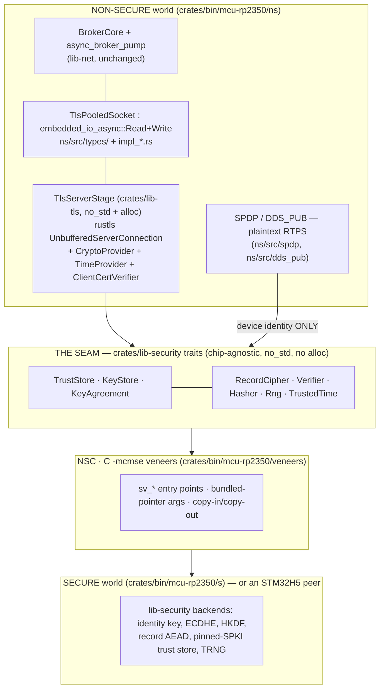

# 0013 — Transport security: one Secure-world trust store behind a seam, serving MQTT/TLS and DDS

**Status:** Proposed (2026-07-26) — EPIC #350. **Design record; no code written yet.** Reviewed before
implementation, per the brief.

Supersedes nothing. Extends ADR [0011](./0011-mcu-security-boundary.md) (the S/NS boundary this
design occupies) and depends on ADR [0010](./0010-mcu-runtime-embassy.md) (Embassy as the MCU
runtime).

## Context

The device **hosts** an MQTT broker on `:1883` (`crates/bin/mcu-rp2350/ns/src/main.rs` `broker_task` →
`lib_net::embassy::pump::async_broker_pump` → `BrokerCore`). It is a server; clients connect
inbound. Today that listener is **plaintext, unauthenticated, and unauthorized** — the repo says so
in its own words (`crates/bin/mcu-rp2350/README.md:309-311`). Separately, the device announces itself
over hand-rolled RTPS (`ns/src/spdp/`, `ns/src/dds_pub/`, 1,172 lines, transmit-only) for
MIL-STD-3071 TMS conformance.

Three research passes (TLS-stack survey, DDS-Security requirement determination, current-state
audit) established the ground truth this record is built on. The load-bearing facts:

- **`lib-security` is already the right shape.** `KeyStore`/`SessionCipher`/`Verifier`/`Rng`/`Hasher`
  are `no_std`, `forbid(unsafe_code)`, opaque-handle seams with a mandatory `custody()` honesty
  accessor and feature tiers (`software` | `wolfcrypt` | `fips` | `trustzone` | `secure-element`).
  The S image already consumes it; `ns` already talks to it across the frozen CMSE veneer ABI
  (`crates/bin/mcu-rp2350/abi`, `veneers/veneer.{h,c}`, `ns/src/impl_veneer_session_cipher.rs`).
- **The socket seam already exists and is generic.** `async_broker_pump` is parameterised over
  `S: embedded_io_async::{Read, Write} + Unpin` and obtains sockets through a caller-supplied
  `FnMut() -> impl Future<Output = Option<S>>`. `BrokerCore` never sees a socket. **`lib-net` needs
  no change to gain TLS** — the whole insertion is `PooledSocket` plus three lines of `main.rs`.
- **Only one TLS stack can be a `no_std` server with client-certificate verification: rustls.**
  `embedded-tls` is client-only and has no client-certificate machinery at all (issue #51 open since
  2022-06-26). `ring` and `aws-lc-rs` do not build for Thumb. `rustls-rustcrypto` is marked
  do-not-use-in-production. BearSSL fits the resource budget beautifully and is killed by protocol
  version (TLS 1.2 max, TLS 1.3 "not implemented yet", no timeline). wolfSSL is the only stack with a
  live FIPS certificate and its Rust bindings are std-only — and cert #4718's operating-environment
  table contains **no Cortex-M33 row**.
- **DDS-Security is NOT required** by the MIL-STD-3071 revision checked in (23 January 2023).
  Appendix C (Cybersecurity Requirements) and §D.6 (DDS-Security) are both, in full, *"This section
  reserved for future use."* DDS-Security appears only in Table D.2, conditional on being
  "security-enabled" — and nothing in the standard makes an implementation security-enabled.
- **Nothing on the MCU is hardware-backed or FIPS today.** `sv_profile` returns
  `SoftwareMemory`/`SoftwareMemory`; the S-world RNG is `InsecureTestRng` seeded from the DWT cycle
  counter; the `veneers` feature is **off in every shipping build**; and `SV_MAX_PAYLOAD = 4096` is
  smaller than `CRYPTO_MAX = 8192`, so **every** seal through the veneer currently fails closed.
- **An STM32H5 migration is live** on FIPS grounds. STM32H5 is also Cortex-M33 with TrustZone-M, so
  the CMSE veneer pattern transfers — but only if Non-Secure code depends on *traits*, never on the
  chip.

The owner's requirement, stated directly: **one trust store and one set of cryptographic operations,
in the Secure world, behind a seam, serving both the MQTT TLS leg and the DDS requirement. Not two
parallel crypto stacks.**

## Decision



### 1. The seam — four new traits in `lib-security`, and deliberately **no** `CryptoOps` god-trait

`crates/lib-security` already provides sign (`KeyStore`), verify (`Verifier`), random (`Rng`),
digest (`Hasher`) and payload AEAD (`SessionCipher`). Adding a `CryptoOps` trait that re-declares
those would duplicate the seam and violate the one-type-per-file / one-concern-per-trait doctrine.
**Four traits are genuinely missing.** All live in `crates/lib-security/src/traits/types/`, one file
each, with impls in `crates/lib-security/src/backends/.../impl_*.rs`, re-exported through
`traits/types/mod.rs`.

**`trust_store.rs` — peer trust and device identity, the single source of both.**

```rust
pub trait TrustStore {
    /// Mandatory honesty accessor — same doctrine as `KeyStore::custody`.
    fn custody(&self) -> KeyCustody;
    /// How peers are trusted: `PinnedSpki`, `X509Chain`, or `RawPublicKey`. Reported, never assumed.
    fn model(&self) -> TrustModel;
    fn anchor_count(&self) -> usize;

    /// Verify a peer credential. On success writes the resolved identity into `out` — the
    /// `AnchorId` is what authorization is keyed on. Fails closed with `UntrustedChain`.
    /// `now` is `None` when `TrustedTime` reports an untrusted clock; a `TrustStore` whose
    /// `model()` needs validity windows MUST fail closed on `None`.
    fn verify_peer(
        &self,
        credential: &PeerCredential<'_>,
        now: Option<UnixSeconds>,
        out: &mut PeerIdentity,
    ) -> Result<()>;

    /// The device's own long-lived key, by purpose. Returns an opaque handle — never bytes.
    fn device_identity(&self, purpose: KeyPurpose) -> Result<KeyHandle>;
    /// The device's own certificate/SPKI to present, DER, copied out (public data).
    fn device_credential(&self, out: &mut [u8]) -> Result<usize>;
}
```

Supporting types, one file each under `traits/types/`: `peer_credential.rs`
(`enum PeerCredential<'a> { RawPublicKey { spki: &'a [u8] }, X509Chain { end_entity: &'a [u8], intermediates: &'a [&'a [u8]] } }`),
`peer_identity.rs` (`{ anchor: AnchorId, spki_sha256: [u8; 32], subject: heapless::String<64> }`),
`anchor_id.rs` (`pub struct AnchorId(pub u16)`), `trust_model.rs`, `unix_seconds.rs`.

**`key_agreement.rs` — ECDHE without exporting the private half.**

```rust
pub trait KeyAgreement {
    fn custody(&self) -> KeyCustody;
    fn generate_ephemeral(&mut self, group: KexGroup) -> Result<KeyHandle>;
    /// Copy out our public share (public data) — e.g. an uncompressed P-256 point.
    fn public_share(&self, handle: KeyHandle, out: &mut [u8]) -> Result<usize>;
    /// Combine with the peer's share. Returns a **handle to the shared secret**, not the secret.
    /// Consumes `handle` (the ephemeral private key is erased).
    fn agree(&mut self, handle: KeyHandle, peer_share: &[u8]) -> Result<KeyHandle>;
}
```

**`key_derivation.rs` — the TLS 1.3 key schedule stays inside the boundary.**

```rust
pub trait KeyDerivation {
    fn extract(&mut self, salt: Option<KeyHandle>, ikm: Option<KeyHandle>) -> Result<KeyHandle>;
    fn expand_label(&mut self, secret: KeyHandle, label: &[u8], context: &[u8], len: usize)
        -> Result<KeyHandle>;
    /// Only for outputs that are legitimately public (Finished-key transcripts are NOT).
    fn expand_to_bytes(&mut self, secret: KeyHandle, label: &[u8], context: &[u8], out: &mut [u8])
        -> Result<usize>;
}
```

**`record_cipher.rs` — TLS record AEAD. A SEPARATE trait from `SessionCipher`, on purpose.**

`SessionCipher`'s contract is that the nonce is a per-key monotonic counter *inside* the store,
never caller-supplied, and that the nonce is carried on the wire as a 12-byte prefix. TLS 1.3 needs
neither: the nonce is `static_iv XOR seq` and is **not transmitted**. Widening `SessionCipher` to
accept a caller-supplied sequence number would weaken the nonce contract for the existing payload
path too. So:

```rust
pub trait RecordCipher {
    fn custody(&self) -> KeyCustody;
    /// Honesty accessor for the S/NS split below: `SecureWorld` or `NonSecureExported`.
    fn protection(&self) -> RecordProtection;

    /// Seal `buf[..len]` in place, appending the tag; returns `len + TAG_LEN`. No nonce prefix.
    /// The store enforces strict per-(key, direction) monotonicity of `seq` and fails closed with
    /// `SecurityError::VerificationFailed` on a repeat or regression — the caller supplies the
    /// sequence number but CANNOT cause nonce reuse.
    fn seal_record(&mut self, key: KeyHandle, seq: u64, aad: &[u8], buf: &mut [u8], len: usize)
        -> Result<usize>;
    fn open_record(&mut self, key: KeyHandle, seq: u64, aad: &[u8], buf: &mut [u8], len: usize)
        -> Result<usize>;
}
```

**`trusted_time.rs` — the clock is its own seam, with its own honesty accessor.**

```rust
pub trait TrustedTime {
    /// `Unavailable` | `Unauthenticated` | `Authenticated`. Security decisions may only consume
    /// `Authenticated`; `Unauthenticated` is an availability input (log timestamps) and is
    /// **never** an input to a validity or revocation check.
    fn trust(&self) -> TimeTrust;
    fn now(&self) -> Result<UnixSeconds>;
    /// Always available: monotonic milliseconds since boot, for timeouts and rate limits.
    fn uptime_millis(&self) -> u64;
}
```

**Consumer ergonomics without a god-trait.** `lib-tls` takes **one** type parameter:

```rust
// crates/lib-tls/src/types/secure_provider.rs
pub trait SecureProvider:
    TrustStore + KeyStore + KeyAgreement + KeyDerivation + RecordCipher + Verifier + Hasher + Rng
{}
impl<T> SecureProvider for T where T: TrustStore + KeyStore + /* … */ {}
```

An aggregation alias with a blanket impl — no new methods, no new god-trait, one generic at the
call site.

**Crate placement, explicitly:**

| Piece | Crate | Notes |
|---|---|---|
| The four traits + supporting types | `crates/lib-security` | `no_std`, **no alloc**, `forbid(unsafe_code)` |
| Software backends (host + `cargo test`) | `crates/lib-security/src/backends/software/` | `p256` (+ `ecdh`), `aes-gcm`, `hmac`/`sha2` |
| Bounded DER SPKI extractor | `crates/lib-security` | new `impl_spki_extract.rs`, no alloc, no recursion, fuzzed |
| rustls glue: provider, verifier, time provider, `TlsServerStage` | **`crates/lib-tls` (new)** | `no_std` **+ `alloc`**; depends on `lib-security` traits only |
| Veneer ABI extension | `crates/bin/mcu-rp2350/abi` | new `sv_*` entry points, ABI version word |
| S-world impls | `crates/bin/mcu-rp2350/s` | or an STM32H5 peer, unchanged NS |
| `VeneerTrustStore`, `VeneerKeyAgreement`, `TlsPooledSocket` | `crates/bin/mcu-rp2350/ns` | `types/` + `impl_*.rs` |

**Chip-agnosticism, concretely:** Non-Secure code links `lib-security` traits and `lib-tls`. The only
chip-specific artifact it links is the CMSE import library. An STM32H5 Secure image satisfies the
same traits over its PKA/AES/RNG (or a wolfCrypt-FIPS module) and Non-Secure changes **zero lines**.
This is not aspirational — it is the same mechanism ADR 0011's channel-boundary invariant already
relies on, and `ns/src/impl_veneer_session_cipher.rs` is the working precedent.

### 2. The S/NS split — the Secure world does the record crypto too, and the reason is measured, not dogmatic

**Decision: private keys, key agreement, the TLS 1.3 key schedule, AND bulk record AEAD all execute
in the Secure world. Traffic keys never cross the veneer as bytes.** Non-Secure holds ciphertext,
plaintext, and opaque `KeyHandle`s only.

The tempting alternative — S does the handshake, then exports the derived traffic keys to NS for
fast record encryption — deserves an honest hearing, because its security argument is genuinely
strong: **NS already holds the plaintext.** The MQTT broker, the topic table and the payloads all
live in NS. Handing NS the traffic keys therefore leaks *nothing NS did not already have*. On pure
confidentiality-against-NS-compromise grounds, exporting is free.

It is rejected on two other grounds:

1. **The performance argument for exporting does not survive arithmetic.** This device publishes
   battery telemetry: order 10–30 records/second across ≤3 clients, ~1 KiB payloads. The veneer cost
   is two `memcpy`s of the record through an S-side scratch — at, say, 100 MB/s, ~20 µs for 1 KiB.
   Software AES-256-GCM on a Cortex-M33 without a crypto accelerator runs on the order of 30–50
   cycles/byte, so the same 1 KiB costs ~40k cycles ≈ **270 µs at 150 MHz**. **The copy is ~7 % of a
   cost we pay either way.** Exporting keys buys single-digit-percent throughput. At a hundred times
   our data rate the answer flips — this justification is rate-dependent and is recorded as such.
2. **A FIPS cryptographic boundary must enclose the record encryption, not just the handshake.** If
   the STM32H5/FIPS path proceeds, "the handshake used validated crypto but the records did not" is
   not a claim worth making. Keeping record AEAD in S means the FIPS decision changes the *backend*,
   not the architecture.

**The honest trade-off, stated plainly:** this decision buys *forward compatibility with a FIPS
boundary* and *architectural consistency with ADR 0011's "keys never leave S"*. It does **not**
meaningfully improve confidentiality against a Non-Secure compromise, because NS holds plaintext by
construction. Anyone reading this ADR should not infer a stronger claim than that.

**The escape hatch is real, explicit and reported.** `RecordCipher::protection()` returns
`RecordProtection::NonSecureExported` if a build ever selects key export. That mode is:
compile-time-gated, **forbidden under the `fips` profile**, and surfaced through the same honesty
plumbing as `custody()` so no log, claim or attestation can mistake it for the default.

**The cost this forces: the S-side scratch must grow.** `SV_MAX_PAYLOAD` is 4096; a TLS 1.3
protected record is up to **16,640 bytes**, and AEAD cannot be split across veneer calls without an
incremental init/update/final ABI (a much larger change). So the record path needs a dedicated
S-side scratch of ~16.7 KiB — **26 % of the 64 KiB S RAM**, which is otherwise near-empty. This is a
frozen-ABI change and gets an explicit ABI version word (see WP-4). It also incidentally fixes the
existing `SV_MAX_PAYLOAD 4096 < CRYPTO_MAX 8192` fail-closed bug in the `veneers` seal path.

If rustls turns out to implement RFC 8449 `record_size_limit` (**open question 1**), we can cap
inbound records and reclaim ~12 KiB of S RAM. We are not assuming it.

### 3. Which TLS stack — rustls, `no_std`, unbuffered server, hand-built provider

**Decision: rustls 0.23+ with `std` off, `UnbufferedServerConnection`, TLS 1.3 only, EC-only, with a
`CryptoProvider` whose primitives route through the `lib-security` seam.**

It is the only viable option; the survey is unambiguous. The three things this decision must own:

- **`alloc` is mandatory and is the single largest doctrinal cost here.** rustls 0.23's own release
  notes: *"`alloc` continues to be required."* Introducing a heap into a previously allocation-free
  NS image is a real regression against the embedded doctrine. Mitigation: a bounded
  `embedded-alloc` heap over a **dedicated static arena** (so `.bss` accounting stays honest), a
  measured high-water mark, and a long-soak connect/disconnect HIL test — fragmentation over a
  multi-week uptime is precisely what the memory arithmetic does not capture. An allocation failure
  is a reset, not a graceful degradation; that is accepted and stated.
- **`UnbufferedServerConnection` on Cortex-M is unexercised territory.** The only official embedded
  rustls demo (`ctz/rustls-embedded-demo`, embassy on STM32F429ZI) is a **client**. We would be
  first. The socket↔state-machine glue and `InsufficientSizeError` handling are ours to write — and
  they go in `lib-tls`, host-tested against a real rustls client, before any target build.
- **rustls has no FIPS story on this chip.** Its only FIPS-capable provider is `aws-lc-rs`, which is
  not a bare-metal target. A rustls deployment is **non-FIPS by construction**. This is why §2's
  boundary decision matters: the FIPS question is answered by what the *provider* calls, and our
  provider calls the seam.

**Certificate profile — pinned SPKI, not PKI. This is the decision that resolves the clock problem.**

- The server presents an **X.509 certificate** so ordinary MQTT clients (mosquitto, paho) can verify
  us against a pinned CA with stock tooling.
- Client authentication uses a **custom `ClientCertVerifier`** over `TrustStore`. The client sends an
  ordinary X.509 certificate; our verifier extracts the `SubjectPublicKeyInfo`, hashes it, and
  matches against a short list of pinned SPKI hashes. **No chain construction. No `notBefore` /
  `notAfter`. No webpki.** `verify_tls13_signature` is implemented over the existing `Verifier` seam.
- Consequences taken with eyes open: this is **pinning, not PKI** — no CRL, no OCSP, no expiry.
  Rotation is a signed configuration push, and that is the *only* revocation mechanism. For a broker
  with three known clients that is the correct trade; at a hundred clients it is not.

RFC 7250 raw public keys (rustls PR #2062) would be strictly cleaner and is the natural end state if
we ever control both ends — but mosquitto and paho do not implement RFC 7250, so it would break the
integration surface today. Recorded as the preferred future form, not adopted now. Whether rustls
permits server-X.509 **and** client-RPK simultaneously is **open question 11**.

**Fallback if WP-3 fails its measurement gate:** terminate TLS on the Pi and run the MCU on a private
link. Stated now so the fallback is a decision rather than a scramble.

### 4. The DDS leg — no DDS-Security; one identity, and compensating controls

**Decision: do not implement DDS-Security. Keep RTPS plaintext on the wire.**

The determination is not a judgement call — the standard we hold says it in two one-line sections.
Appendix C and §D.6 are both *"This section reserved for future use."* DDS-Security is absent from
Table D.1 (Required DDS Standards) and appears only in Table D.2, conditioned on being
"security-enabled", a state nothing in the standard mandates. The mandatory wire contract (XCDR2,
domain 0, IDL topic names, UDP/IPv6/Ethernet) is what `ns/src/spdp/` and `ns/src/dds_pub/` already
emit. There is no security layer in §5.4's stack table; IPsec and MACsec appear nowhere in the
document.

Implementing it anyway would be a **prerequisite rewrite, not a feature**: DDS-Security mandates
twelve bidirectional secure builtin endpoints, one of them reliable+volatile+crypto-protected,
against a 1,172-line **transmit-only** encoder with no receive path (`git grep -n recv_from --
ns/src` returns nothing), no ACKNACK, no reader, no remote-participant state — plus a PKI-DH
handshake, an S/MIME (CMS) verifier and an XML parser in `no_std`. It would also **break the
CycloneDDS interop we verified on the bench**, since a secure participant moves discovery onto the
secure SPDP/SEDP endpoints and an unsecured peer will not match it.

What we do instead:

1. **The same trust store serves DDS.** `TrustStore::device_identity(KeyPurpose::Identity)` is the
   one device key — the TLS server identity and the DDS/TMS `tms.Identity` binding are the same
   handle, in the same custody, reported by the same `custody()` accessor. That is the concrete
   answer to "one trust store, not two crypto stacks." If DDS-Security ever *is* mandated, the same
   `TrustStore` supplies the Identity-CA anchor and the same `KeyAgreement` supplies PKI-DH's ECDH —
   the seam is the forward-compatibility mechanism.
2. **Deployment-layer protection, documented as compensating controls.** Segmented enclave, no
   routable exposure of the RTPS multicast domain, signed firmware, audit logging. §4.7 of the
   standard already routes this: the obligation is RMF / SP 800-53r5 / SP 800-82r2, assessed by an
   ATO authority, and §1.5 disclaims the document as a sole cybersecurity source. Under that framing
   a documented compensating-control set is a **control-assessment artifact, not a conformance
   deviation**. It lands in `docs/compliance/attestation.md` (OSCAL assessment-results) — machinery
   the repo already carries.
3. **Not proposed:** signing the TMS `Identity`/DeviceInfo payload to bind the announced identity to
   the device key over plaintext RTPS. It is attractive and cheap (one `KeyStore::sign`), but the IDL
   governs the shapes and whether a signature field exists is unchecked. Recorded as **open question
   14**, not as scope.

**§B.3 of the standard does state** that *"a strong, cryptographically protected identity … is
required"* — and then defers the mechanism to Chapter C, which is empty. We discharge the stated
intent (a hardware-custodied identity key behind the seam) and are explicit that the wire-level
mechanism is deferred by the standard itself, not by us.

**This determination can be reversed by a change notice (open question 10) or by a contract (open
question 15).** So that the reversal is a scoping exercise rather than a redesign, §8 names the exact
modules, functions and traits DDS-Security would attach to. It is written now, while the seam is
being defined, and it is deliberately *not* scoped work.

### 5. The absent real-time clock

**Decision: no certificate validity window is enforced on any path we control, and that is a design
consequence of §3's pinning model rather than a gap papered over.**

- **Client auth:** SPKI pinning has no validity window to check. `TrustStore::verify_peer` is called
  with `now: None` and succeeds, because `model()` is `PinnedSpki`. A future `X509Chain` model MUST
  fail closed on `None` — the trait signature makes that a compile-visible obligation.
- **Our own server certificate:** clients enforce *our* validity window against *their* clocks. Our
  certificate must therefore be long-lived, and that is the client's trust decision, not ours.
- **rustls still requires a `TimeProvider`**, and the `no_std` default is unavailable. We supply one
  over `TrustedTime`, returning the epoch when `trust() == Unavailable`. Because no code path
  consumes it for a security decision, a stub is safe **only while the pinning model holds** — this
  coupling is deliberate and is called out so a later switch to chain validation cannot silently
  inherit a stub clock.
- **Unauthenticated SNTP is explicitly not a security control.** An attacker who controls
  unauthenticated time can resurrect expired or revoked credentials. SNTP may be wired for log
  timestamps and reported as `TimeTrust::Unauthenticated`; it may never feed a validity check.
- **The upgrade path is Roughtime or enclave-signed time** (`TimeTrust::Authenticated`), which is
  what would unlock real X.509 validation and revocation. Not in scope now.

### 6. Client authentication and authorization

- **mTLS is mandatory.** `ClientCertVerifier::client_auth_mandatory()` returns `true`; a client that
  presents no certificate, or one whose SPKI is not pinned, fails the handshake. Handshake failure
  returns `None` from the `accept_source` closure, which the pump's existing
  `Either3::First(None)` arm already handles — **no new error path in `lib-net`**.
- **TLS is the only authentication mechanism.** MQTT CONNECT username/password stays disabled on the
  MCU broker; there is no second, weaker door. (`lib_mqtt::broker::seam_auth` is the Pi/rumqttd path
  and is unaffected.)
- **Topic ACLs are IN SCOPE, as a separate work package.** Each `AnchorId` maps to a publish-allow
  and subscribe-allow set of topic filters, held as a static table. This is deliberately split from
  the TLS work because it is the **only** part that touches `lib-net`: `BrokerCore` needs an
  `authorize(slot, action, topic) -> bool` policy seam and the accept path needs to carry
  `PeerIdentity.anchor` into the slot. Keeping it separate preserves the zero-blast-radius property
  of the TLS insertion.
- **Default-deny.** An anchor with no ACL entry may do nothing. A slot with no bound identity may do
  nothing.

### 7. Staged implementation plan

Host-testable work packages are the majority, per doctrine — logic proven with `cargo test` / Miri /
fuzz before any target build. `H` = host-testable, `T` = target/HIL only.

| WP | Scope | Dep | Type |
|---|---|---|---|
| **WP-0** | `lib-security` seam definition: `TrustStore`, `KeyAgreement`, `KeyDerivation`, `RecordCipher`, `TrustedTime` + supporting types, one file each under `traits/types/`, re-exported. No impls. | — | **H** |
| **WP-1** | Bounded, alloc-free, non-recursive DER `SubjectPublicKeyInfo` extractor + `cargo-fuzz` target + Miri. Parses attacker-controlled input — this is the sharpest edge in the design. | WP-0 | **H** |
| **WP-2** | Software backends: `SoftwareTrustStore` (pin list in `heapless::Vec<[u8;32], N>`), `SoftwareKeyAgreement` (`p256` + `ecdh`), `SoftwareKeyDerivation` (HKDF), `SoftwareRecordCipher` (AES-GCM, explicit `seq`, monotonicity enforced), `StubTime`. Extend `lib-security/tests/matrix.rs`. | WP-0, WP-1 | **H** |
| **WP-3** | **`crates/lib-tls` — the risk WP.** rustls `CryptoProvider` over the seam, `TimeProvider` over `TrustedTime`, pinned-SPKI `ClientCertVerifier`, and `TlsServerStage` exposing the same four-method protocol as the existing `TlsStage` (`feed_incoming`/`drain_outgoing`/`write_plaintext`/`read_plaintext`/`is_handshaking`). **Gate: it must produce a measured `thumbv8m` flash/RAM/heap-high-water figure and a host handshake against a real rustls client before WP-6 starts.** | WP-2 | **H** |
| **WP-4** | Veneer ABI extension in `abi` + `veneers/`: `sv_sign`, `sv_agree`, `sv_derive`, `sv_record_seal`, `sv_record_open`, `sv_verify_peer`, `sv_trusted_time`; **ABI version word**; record scratch grown to 16,704 B; `SV_MAX_AAD` promoted into the frozen ABI. Const-assert tests + error/custody round-trips run on host. | WP-0 | **H** (mappings) / **T** (veneer) |
| **WP-5** | S-world implementation: **replace `InsecureTestRng` with the RP2350 ring-oscillator TRNG**, provision the identity key, populate the pinned trust store, wire `sv_profile` to a *live* store query rather than the compile-time `SecurityProfile::active()`. **No honest security claim is possible before this lands.** | WP-4 | **T** |
| **WP-6** | NS wiring: `TlsPooledSocket` (`ns/src/types/` + `ns/src/impl_tls_pooled_socket.rs`), handshake driven from the `accept_source` closure after `accept(1883)`, three lines changed in `main.rs` (socket construction, accept, the `async_broker_pump::<…>` type argument). Bounded heap arena. | WP-3, WP-5 | **T** |
| **WP-7** | Authorization: `BrokerCore::authorize(slot, action, topic)` policy seam in `lib-net`, static ACL table keyed by `AnchorId`, identity plumbed accept → slot. Default-deny. | WP-2 | **H** |
| **WP-8** | HIL bring-up on the bench Pi 5: mTLS handshake from a pinned mosquitto client, measured handshake latency, NS static/heap high-water, re-blessed stack audit, **long-soak connect/disconnect fragmentation test**. | WP-6, WP-7 | **T** |
| **WP-9** | Compliance record: DDS compensating-control set into `docs/compliance/attestation.md` (OSCAL assessment-results), update `docs/security/`, and re-check MIL-STD-3071 against ASSIST for a change notice. | — | **H** |

WP-0/1/2/3/7/9 are all host work and can proceed in parallel with the target track. **WP-3 is the
gate**: if its measured footprint or handshake latency fails, the fallback in §3 applies and WP-4/5/6
are re-scoped rather than started.

### 8. Where DDS-Security would be implemented, if it is ever required

§4 determines DDS-Security is not required by the standard we hold. This section does not reopen
that. It answers the *next* question — **if a change notice or a contract mandates it, where in this
platform does it go, and does the seam defined above survive?** The answer is that four of the five
OMG plugins consume traits WP-0 already defines and attach to modules that already exist; the
expensive part is not the security plugins but the bidirectional RTPS core they assume, which we do
not have. Both halves of that are stated below.

| OMG plugin (DDS-Security 1.1) | Built-in profile | Where it lands in this repo | `lib-security` seams it consumes |
|---|---|---|---|
| **Authentication** | `DDS:Auth:PKI-DH` | `ns/src/spdp/` — announcement parameters, plus a receive path and a handshake module that do not exist yet | `TrustStore`, `KeyStore`, `Verifier`, `KeyAgreement`, `Hasher`, `Rng` |
| **Access Control** | `DDS:Access:Permissions` | the same policy seam WP-7 builds for the broker ACL — extended, not duplicated | `TrustStore`, `Verifier`, `TrustedTime` |
| **Cryptographic** | `DDS:Crypto:AES-GCM-GMAC` | `ns/src/dds_pub/` — inside `encode_sedp` and `encode_data` | `KeyDerivation`, `RecordCipher`, `Rng` |
| **Logging** | `DDS:Logging:DDS_LogTopic` | a builtin log writer in `ns/src/dds_pub/`; the durable record stays `docs/compliance/attestation.md` | `TrustedTime`, optionally `KeyStore` |
| **Data Tagging** | `DDS:Tagging:DDS_Discovery` | `DdsPublisher::encode_sedp` (a data-tags parameter) and per-sample inline QoS | none |

**Authentication — one small insertion point in SPDP, and one large one.**

*Advertisement* is the small half. A security-enabled participant advertises identity and permissions
tokens and its secure builtin endpoints in the SPDP announcement. That is `SpdpAnnounce::encode`
(`ns/src/spdp/impl_spdp_announce.rs:91`) gaining identity-token, permissions-token and
participant-security-info parameters alongside the ones it already writes, and `BUILTIN_ENDPOINT_SET`
(`ns/src/spdp/mod.rs:131`, today `0x07`) gaining bits from the **16–27 block DDS-Security 1.1
reserves** — the twelve secure builtin endpoints. dust_dds's own source records that reservation
without implementing any of it
(`vendor/dust_dds/src/dcps/data_representation_builtin_endpoints/spdp_discovered_participant_data.rs:69`).
The token contents come straight off the seam: `TrustStore::device_credential` is the identity
certificate the token carries, and `TrustStore::device_identity(KeyPurpose::Identity)` is the key
that proves possession of it — the *same* handle the TLS server identity uses.

*The handshake* is the large half. PKI-DH is a three-message exchange (Request / Reply / Final)
carried over the **ParticipantStatelessMessage** builtin endpoint pair — a bidirectional RTPS
conversation on the metatraffic port. `spdp_task` cannot host that today: it binds `:7400` and its
loop (`ns/src/spdp/mod.rs:239-263`) contains nothing but an encode and a `send_to`; `SPDP_RX_BUF` is
allocated and never read; `git grep -n recv_from -- crates/bin/mcu-rp2350` returns nothing. **The
insertion point is a new `recv_from` arm in that loop**, selected against the announce timer, feeding
a new sibling module (`ns/src/spdp_auth/`, split `types/` + `impl_*.rs` per the repo's file doctrine)
that owns the handshake state machine and the per-remote-participant state SPDP does not keep.

Every cryptographic step of that state machine is a trait this ADR already defines. The peer's
identity certificate is validated by `TrustStore::verify_peer` against an Identity-CA anchor; the
challenge nonces come from `Rng`; the ephemeral Diffie-Hellman is `KeyAgreement::generate_ephemeral`
→ `public_share` → `agree`, which returns a **handle** to the shared secret so the secret never
crosses the veneer as bytes; the message signatures are `KeyStore::sign` and `Verifier::verify`; the
transcript digests are `Hasher`. **No new trait is required, and no second key custody exists.**

**Cryptographic — the publish path.**

The Cryptographic plugin protects at three granularities: serialized payload, RTPS SubMessage, and
whole RTPS message. All three attach inside `ns/src/dds_pub/`:

- `DdsPublisher::encode_data` (`ns/src/dds_pub/impl_dds_publisher.rs:237`) renders the XCDR2 payload
  into the `payload` scratch and copies it into a DATA submessage. **Payload protection** wraps the
  rendered payload before that copy; **SubMessage protection** wraps the finished DATA submessage,
  replacing it with a secure-prefix / secured-body / secure-postfix triple.
- `DdsPublisher::encode_sedp` (`:124`) needs the same treatment, and under DDS-Security the announce
  moves onto the *secure* SEDP endpoints rather than the ones it uses today.
- Whole-message protection wraps everything after the RTPS `Header` — the outermost framing both
  encoders build through `ByteCursor`.

The primitive is AES-GCM, with a GMAC variant for authenticate-only. That is the primitive
`RecordCipher` already exposes, in the same shape: a key handle, a caller-supplied non-repeating
counter, associated data, in-place seal. Session keys derive from the Authentication plugin's
shared-secret handle, which is what `KeyDerivation` is for. So the Cryptographic plugin is
`KeyDerivation` + `RecordCipher` + `Rng`, and **the bulk crypto stays in the Secure world for exactly
the reason §2 keeps TLS records there** — a FIPS boundary that encloses the handshake but not the
data is not a boundary worth claiming.

One honest wrinkle: `RecordCipher`'s documentation is written in TLS terms and enforces strict
per-(key, direction) monotonicity of `seq`. DDS-Security constructs its initialisation vector from a
session id plus a counter rather than a TLS sequence number. The monotonicity contract still holds
and the signature still fits, but the doc comment would widen from "TLS record" to "protected
record". That is a documentation change, not an ABI change — which is the point of recording it here.

**Access Control — extend WP-7, do not build a second authorizer.**

The Access Control plugin decides which participant may write or read which topic. That is the same
decision WP-7's `authorize(slot, action, topic) -> bool` seam makes for MQTT, keyed on `AnchorId`. A
future implementer should add a DDS-side caller to that seam rather than write a parallel one — this
is the concrete payoff of the owner's "one trust store, not two crypto stacks" requirement extending
past TLS.

What differs is *where the table comes from*. WP-7's is a static compiled-in table; DDS-Security's is
a pair of **XML documents — governance and permissions — signed with S/MIME (CMS)** by a Permissions
CA. Verifying those is `Verifier` + `TrustStore` over a CMS parser and an XML parser in `no_std`. It
is the largest genuinely new code in the whole plugin set, and it is the same class of
attacker-controlled-input parsing that WP-1 already identifies as the sharpest edge in this design;
it would need the same fuzz + Miri treatment.

It also collides with §5, and the collision is not reinterpretable. **Permissions documents carry
validity windows.** SPKI pinning had nothing to check and so tolerated an absent clock; Access
Control does not. An implementation needs `TrustedTime::trust() == Authenticated`, which this device
does not have. **DDS-Security therefore drags the trusted-time problem onto the critical path in a
way the TLS design deliberately avoided** — Roughtime or enclave-signed time stops being a future
nicety and becomes a dependency. Recorded as **open question 20**.

**What it would actually cost — stated plainly, because the plugin table above reads deceptively
cheap.**

Our RTPS is hand-rolled: 1,172 lines, transmit-only, no reader, no ACKNACK servicing (the SEDP
HEARTBEAT is deliberately sent with the Final flag so that no ACKNACK leg is needed —
`ns/src/dds_pub/mod.rs:71-77`), and no remote-participant state. DDS-Security assumes a complete
bidirectional DDS implementation underneath it and then adds twelve secure builtin endpoints, one of
them reliable, volatile and crypto-protected. **The plugins are not the expensive part; the DDS core
they presuppose is.** Hand-rolling it is a work programme on the order of — plausibly larger than —
the entire TLS effort in §7, and unlike the TLS work it cannot be mostly host-tested against a mature
counterpart, because we would be writing both ends of the state machine ourselves.

The escape hatch is to not hand-roll it. `crates/lib-dds` already defines `DdsParticipant` /
`DdsWriter` seams with a swappable backend — but it is **Pi-only and `std`** by its own module doc,
and its `dust_dds` backend implements no DDS-Security. On the MCU the stated blocker for linking any
RTPS library was `alloc` (`ns/src/spdp/mod.rs:23`) — a premise **WP-3 changes**, since rustls brings a
bounded heap into the NS image regardless. Whether any `no_std`-viable RTPS crate with DDS-Security
exists is unchecked (**open question 19**); if one does, the calculus above changes completely.

**Interop consequence — the bench peer breaks.** Our verification peer is Eclipse CycloneDDS
(`docs/testing/mcu-dds-spdp-hil.md`). A secured participant does not match an unsecured one:
discovery moves onto the secure builtin endpoints and an unsecured peer never matches. Enabling
DDS-Security therefore requires the CycloneDDS side to be **built with security compiled in** (a CMake
option requiring OpenSSL — open question 17) and configured with a matching governance document,
permissions document, Identity CA and participant certificate. The existing HIL recipe would need a
parallel secured variant, and the plaintext recipe would stop working against a secured device unless
the governance document sets `allow_unauthenticated_participants` — which would defeat the purpose.

**Platform-wide, not MCU-only.** A contract that mandates DDS-Security will mandate it for the Pi
too. There the shape is different and easier: `crates/lib-dds`'s `DdsParticipant` seam is the
insertion point and the change is **backend selection** — a backend whose DDS stack ships the
plugins — rather than a protocol implementation, in a `std` environment where OpenSSL is available.
The trust material is the same question on both targets, which is why this ADR defines the trust
store chip-agnostically rather than per-target.

**Caveat on the specifics.** The plugin names, profile names, endpoint roles and the reserved
BuiltinEndpointSet block above come from the DDS-Security 1.1 specification text as read during the
research pass; only the reserved-bits fact is corroborated by a file checked into this repo. The
secure-submessage identifiers and secure builtin endpoint ids are **not** reproduced here on purpose,
because they were not verified against a checked-in copy of the spec — see **open question 18**.

## Consequences

**What this gives us.**

- One trust store, one identity key, one set of crypto seams — consumed by TLS, by DDS, and by the
  existing payload `CryptoStage`. Not two stacks.
- A broker that is authenticated and authorized rather than open, with the authentication decision
  made against key material Non-Secure code cannot read.
- A chip migration that costs zero Non-Secure lines. STM32H5 is also Cortex-M33 + TrustZone-M; the
  veneer pattern and the trait set both transfer.
- The blast radius in `lib-net` for the TLS leg is **zero** — the generic `S: Read + Write` bound and
  the `accept_source` closure were already the right seam. Only the ACL work (WP-7) touches it.
- **A named landing site for DDS-Security, should it ever be mandated.** §8 maps four of the five OMG
  plugins onto traits WP-0 already defines and names the modules and functions they attach to; the
  fifth (Access Control) needs new machinery — a CMS and XML verifier — but still consumes `Verifier`
  and `TrustStore`. A future implementer extends the seam instead of re-architecting around it.

**What this does NOT give us — stated so nobody infers it.**

- **No FIPS.** rustls has no FIPS-capable provider that builds for Cortex-M. wolfCrypt cert #4718's
  OE table has no Cortex-M33 row at all. This design is *forward-compatible* with a validated module
  behind the seam; it is not a FIPS claim.
- **No confidentiality against a Non-Secure compromise.** NS holds plaintext by construction. Keeping
  record crypto in S protects *keys*, not *data*, against that adversary. §2 says this outright.
- **No PKI.** SPKI pinning has no revocation, no expiry, no CRL/OCSP. Rotation is a signed config
  push and that is the entire revocation story.
- **No trusted time.** Consequently no validity windows and no time-based revocation, by design.
- **No DDS wire protection.** RTPS stays plaintext; the control is the enclave, recorded as a
  compensating-control artifact. §8 is the map for reversing that decision — it is not a claim that
  reversing it is cheap. The plugins are affordable; the bidirectional RTPS core they presuppose,
  and the authenticated clock Access Control requires, are not.
- **The boot chain underneath is still unverified.** `s/src/ns_jump.rs` does not check a signature
  over the NS image, and `s` has no IMAGE_DEF (`s/memory.x:29-42`), so the S image is not
  demonstrated boot-ROM-loadable. A TLS server in NS sits on that. Unchanged from ADR 0011, restated
  because it bounds every claim above.
- **DMA still bypasses the SAU** (`ACCESSCTRL` unwired) — ADR 0011's open gap applies unchanged.

**Cost.**

- **NS RAM:** ~21 KiB of static TLS buffers per session (16.6 KiB inbound record + ~4 KiB outbound)
  × 3 sessions ≈ 62 KiB, plus a bounded heap of ~35 KiB (handshakes serialised) to ~100 KiB (three
  concurrent). Against 448 KiB NS RAM at 90.6 KiB static today, that takes static to roughly
  **160–190 KiB (36–42 %)**, leaving ~260 KiB of stack headroom against a 26 KiB worst-case frame.
  It fits with margin. **Every one of these numbers is derived from cited record-size constants and
  the rustls demo's *client* heap figures — none is a measured `thumbv8m` server figure. WP-3 exists
  to replace this arithmetic with measurement.**
- **S RAM:** +16.7 KiB for the record scratch, 26 % of the 64 KiB S region (currently near-empty).
- **Flash:** unknown — no published rustls + RustCrypto + `thumbv8m` figure exists. At 113 KiB of an
  8 MiB window, flash is not the constraint.
- **CPU:** a 2-cert mTLS handshake is ~4.2M cycles ≈ 28 ms at 150 MHz *with hand-written asm P-256*
  (Emill/P256-Cortex-M4). Pure-Rust `p256` is materially slower by an **unmeasured** multiplier.
  Treat 28 ms as a floor, not an estimate. Pinning removes the chain walk, which is the largest
  saving available to us.
- **Doctrine:** a heap enters the NS image. This is the design's biggest concession and is mitigated,
  not eliminated.

**Interaction with the pending STM32H5 / FIPS decision.**

This ADR is deliberately structured so the chip decision changes only backends. If STM32H5 is
adopted: NS is unchanged; a new `s` peer implements the same traits over PKA/AES/RNG; the FIPS
question becomes "does the module behind `RecordCipher`/`KeyStore` hold a certificate covering this
OE" — which is exactly the question §2 kept answerable by refusing to export traffic keys. If
STM32H5 is *not* adopted, nothing here changes. **The seam is the hedge, and it is the reason this
decision can be taken before the chip decision is.**

## Open questions

Every item below was **UNVERIFIED** in the research that produced this ADR. None is resolved by
assumption. Items 1–4 and 12 gate WP-3; item 10 gates §4's entire determination. Items 6 and 7 have
since been resolved by direct verification against NIST (2026-07-27) and are kept here, marked
RESOLVED, as useful history rather than deleted.

1. **Does rustls implement RFC 8449 `record_size_limit`?** The single most consequential item for the
   RAM budget. Without it, a server must budget the full 16,640-byte inbound record (RFC 6066
   `max_fragment_length` is client-driven — a server cannot request a lower limit). Resolve by
   grepping the rustls source before sizing the S scratch; a positive answer reclaims ~12 KiB of S RAM.
2. **No public example of `UnbufferedServerConnection` on Cortex-M or under embassy exists.** The only
   official embedded demo is a client. The socket↔state-machine glue and `InsufficientSizeError`
   handling are unexercised.
3. **No published flash/RAM figures for rustls + a RustCrypto provider + `thumbv8m`.** Every memory
   number in §Consequences is derived arithmetic or a client-side figure. The demo's README figures
   and its current source constants do not even agree with each other.
4. **RustCrypto `p256` ECDSA-verify performance on Cortex-M33 is unmeasured.** The 28 ms handshake
   figure is a floor derived from hand-written asm, not an estimate for pure Rust.
5. **Does `rustls-webpki` link on `thumbv8m` in a fully alloc-free (EC-only, no RSA) configuration?**
   Documented, not tested. Lower stakes under the pinning model, which avoids webpki entirely.
6. **RESOLVED 2026-07-27.** *Was: NIST CMVP certificate #4718's own tested-OE list was not rendered
   on the page fetched; the OE analysis comes from wolfSSL's published page. Confirm against
   `140sp4718.pdf` before any written FIPS claim.* A verification pass read the full 45-page Security
   Policy PDF for cert #4718 directly, including the complete Tested Operational Environments table
   (Table 5, 27 rows: FreeRTOS, OpenRTOS, NET+OS, MQX, CodeOS, Fusion Embedded RTOS, Linux, Android
   and Yocto, on hardware including STM32L4R5 (Cortex-M4), i.MX6UL/7/8, Cortex-A7, PowerQUICC and
   Blackfin). **There is no Cortex-M33 row of any kind — neither RTOS-hosted nor bare-metal.** The
   finding is now sourced from NIST itself, not from wolfSSL's published page, and it corroborates
   §Consequences' "no FIPS" claim rather than merely restating it. wolfSSL's other Active certificate,
   #5041, was also checked directly: its OE table is 4 rows, Intel x86 only (Linux 4.4/Ubuntu 16.04
   and Windows 10, both ±PAA, on Core i5-5300U) — no ARM at all, and so no help either. **Residual
   gap:** only the two currently-**Active** wolfCrypt certificates (#4718, #5041) were checked;
   superseded/historical wolfCrypt FIPS 140-2 certificates were not exhaustively searched, and
   certificate status changes over time. All certificate facts in this ADR were verified against live
   NIST CMVP listings on 2026-07-27.
7. **RESOLVED 2026-07-27.** *Was: What "Cesium 2.93" is in #4718's OE table (the STM32H753 row) — the
   only apparently no-traditional-RTOS entry. Matters only if a bare-metal OE precedent is to be
   argued.* Cesium is itself an RTOS (Cesium RTOS), so that row was never a bare-metal precedent in
   the first place — but the question is moot regardless: the STM32H753 is a **Cortex-M7**, not a
   Cortex-M33, so it could not serve as an M33 precedent no matter what runs on it. Resolved on the
   Cortex-M7 grounds alone, which are sufficient.
8. **Does rustls expose an external-PSK path** usable as a degraded fallback if WP-3's footprint gate
   fails? Not investigated.
9. **Does rustls's send-side "tunable fragment size" knob** bound *outbound* records to ≤ the veneer
   scratch, independently of the inbound question?
10. **Change-notice skew on MIL-STD-3071 — the determination in §4 is scoped to the document we
    hold.** `docs/compliance/README.md:7` claims "w/ Change 2"; the checked-in PDF's cover reads only
    "23 January 2023" with no change-notice page and zero hits for "Change 1/2/Notice" across 411
    pages. If a change notice on ASSIST populates Appendix C or §D.6, the "reserved for future use"
    finding is **superseded**. ASSIST was not reachable (CAC-gated). This is WP-9's first task.
11. **Can rustls negotiate server-X.509 and client-RPK simultaneously?** RFC 7250 defines
    `server_certificate_type` and `client_certificate_type` independently, so it is protocol-legal;
    whether rustls exposes it is unchecked. Determines whether the RPK end-state in §3 is reachable
    incrementally.
12. **Can a bounded `embedded-alloc` heap survive months of connect/disconnect churn without
    fragmentation failure?** No arithmetic answers this. WP-8's soak test is the only oracle.
13. **DDS-Security 1.2 exists and was not read.** Table D.2 names 1.1, so 1.1 is the correct version
    for §4, but 1.2's conformance clause may differ.
14. **Does the TMS IDL admit a signature field on `tms.Identity`/DeviceInfo?** Determines whether the
    identity-binding idea in §4.3 is in scope or is inventing scope. Unchecked against the IDL.
15. **Is DDS-Security mandated by contract rather than by spec?** §6.3 explicitly contemplates
    per-acquisition tailoring of sections 4 and 5. The standard is silent; a SOW could differ. This
    is a contracts question, outside a spec read.
16. **Is the "3 of 5 DDS-Security plugins mandatory" reading correct?** Inferred from the exclusion
    pattern in §2.2/§2.3 of DDS-Security 1.1, not stated in those words. Only matters if item 10 or
    15 flips.
17. **Does the CycloneDDS 11.0.1 image on the bench have security compiled in?** It is a CMake option
    requiring OpenSSL; the default is unstated. Matters only if we ever need to demonstrate the
    interop break in §4 empirically — it is currently derived from the spec, not observed. §8 makes
    it a prerequisite rather than a curiosity if DDS-Security is ever enabled.
18. **§8's DDS-Security specifics are spec-text recall, not repo-verified.** Only the reserved
    BuiltinEndpointSet block (bits 16–27) is corroborated by a file in this repo
    (`vendor/dust_dds/.../spdp_discovered_participant_data.rs:69`). The secure-submessage
    identifiers, the secure builtin endpoint ids, the exact parameter ids for the identity/permissions
    tokens, and the precise PKI-DH message field layouts are deliberately **not** reproduced in §8
    and must be read out of the specification before any of it is implemented.
19. **Is there a `no_std`-viable RTPS/DDS crate that implements DDS-Security?** Not surveyed.
    `dust_dds` needs `alloc` and implements none of the plugins. The premise recorded in
    `ns/src/spdp/mod.rs:23` — that no RTPS library is linkable because of `alloc` — is *changed* by
    WP-3, which brings a bounded heap into the NS image anyway. Worth re-asking at that point: it is
    the difference between hand-rolling a bidirectional DDS core and configuring one.
20. **Can DDS-Security's Access Control plugin work without an authenticated clock?** Permissions
    documents carry validity windows, so on the face of it no — which would put Roughtime or
    enclave-signed time (§5) on the critical path the moment DDS-Security is mandated. Whether a
    governance/permissions document may be issued with an unbounded window, and whether any
    implementation accepts one, is unchecked.

Items not carried forward because the decisions they touch were rejected on other grounds: BearSSL's
release cadence (rejected on TLS 1.3 absence), `fortanix/rust-mbedtls` `thumbv8m` viability (rejected
on maintenance mode + explicitly not FIPS), CycloneSSL footprint and FIPS status (rejected on absence
of any published data).

## Revisit trigger

- **WP-3's measurement lands** — a real `thumbv8m` footprint either confirms §Consequences or
  triggers the §3 fallback.
- **Open question 1 resolves** — a positive answer shrinks the S scratch and may reopen the
  `SV_MAX_PAYLOAD` bump.
- **Open question 10 resolves against us** — a MIL-STD-3071 change notice populating Appendix C or
  §D.6 makes §4 obsolete and puts a bidirectional reliable RTPS core on the critical path. §8 is the
  implementation map for that case.
- **A contract mandates DDS-Security independently of the spec** (open question 15) — same map, same
  cost, and it arrives without the warning a change notice would give. The seam holds; the RTPS core
  and the authenticated clock are the exposure.
- **The STM32H5 decision lands either way** — validates the chip-agnostic claim, and turns the FIPS
  question from architectural to backend-selection.
- **A rustls FIPS provider that builds for Cortex-M appears**, or wolfCrypt adds a Cortex-M33 OE to
  a live certificate — either would change §3's stack choice.
- **Client count grows past a handful** — SPKI pinning stops being the right trade and real PKI
  (with the trusted-time and revocation machinery it drags in) becomes necessary.
- **A trusted time source becomes available** (Roughtime, enclave-signed time) — unlocks validity
  windows and time-based revocation, and changes §5 from "by design" to "now optional".

## Appendix A — the TLS stack survey behind §3

§3 records the choice. This appendix records the comparison that produced it, in full, so the
decision can be **audited rather than taken on trust** — and so that a reader who would have chosen
differently can see exactly which fact stopped each alternative.

Five stacks were evaluated against four **hard** requirements. The device is a server, so the stack
must implement a TLS **server**. Client authentication is the whole point (§6), so it must support
**client-certificate verification**. It must build for **`no_std` Cortex-M33**. And it must be
consumable from **Rust** without a C build system inside the firmware image. A fifth, **soft**
requirement — a credible FIPS path — was scored but was not treated as disqualifying, because §3
already concedes there is no FIPS answer on this chip today.

| Stack | TLS server | Client certs | `no_std` Rust | TLS 1.3 | FIPS | Verdict |
|---|---|---|---|---|---|---|
| embedded-tls | **No** | **No** | Yes | Yes | No | Disqualified — client-only, and no certificate machinery at all |
| BearSSL | Yes | Yes | third-party C bindings only | **No — 1.2 max** | No | Disqualified — protocol version |
| wolfSSL | Yes | Yes | **No — `std`/libc bindings** | Yes | **Yes — cert #4718** | Disqualified — no `no_std` binding; certificate does not cover Cortex-M33 |
| Mbed TLS | Yes | Yes | binding in **maintenance mode** | Yes | **Explicitly not certified** | Disqualified — unmaintained binding, no FIPS |
| **rustls** | **Yes** | **Yes** | **Yes** — `alloc` required | Yes | No provider builds for Cortex-M | **Chosen** |

### embedded-tls — disqualified, and the one a reader will expect us to have used

This is recorded first and at length because it is the crate the embassy ecosystem reaches for. It is
pure Rust, it is `no_std`, and it is in the same async idiom as the rest of the Non-Secure image. A
reviewer who skims §3 will assume we overlooked it. We did not.

It is **client-only**, and not by accident of packaging. Server support is tracked in **issue #51,
open since 2022-06-26**, with no maintainer commitment to implement it; docs.rs states plainly that
**no `TlsServer` type exists**. The device in this design is a server. That single fact ends the
evaluation.

A second, independent disqualification is worth recording because it would survive even if #51 were
closed tomorrow: **embedded-tls cannot present a client certificate or hold a CA store.** The entire
surface of `TlsConfig` is `new`, `enable_rsa_signatures`, `with_server_name`, `with_alpn`,
`with_max_fragment_length`, `reset_max_fragment_length` and `with_psk` — no trust anchors, no
certificate, no verifier hook. Its only mutual-authentication-shaped primitive is **PSK**, which is a
different trust model: a shared symmetric secret per peer, with no binding of identity to a key held
in a custody boundary. That is not the model §3 needs, and it is not the model a defence integrator's
assessor will expect to see for device authentication.

### BearSSL — the best resource fit in the survey, killed by protocol version

On resource grounds this is the stack the device wants. Its author's stated design property is that
there is **"not a single malloc() call in all the library"**, and a minimal server profile runs at
roughly **20 kB of code and 25 kB of RAM**. That is an order of magnitude inside our budget, and —
more importantly — choosing it would have avoided §3's `alloc` concession entirely, which is the
single largest doctrinal cost in this whole design. Client certificates are supported on both sides.
Had the protocol version been there, this appendix would have a different conclusion.

It is disqualified on one fact: **TLS 1.2 is the maximum version.** The project's TLS 1.3 page
presents a roadmap that has not been started, with no timeline attached. Version 0.6 is
self-described as **"beta-quality"**. The Rust bindings are third-party and 0.0.1-grade. A design
being handed to an integrator whose end customer is US government or defence cannot ship
TLS-1.2-only in 2026; that is a finding an assessor writes up before reading anything else about the
system. BearSSL's release cadence was a live concern during the survey and is *not* carried into the
open questions, because it stopped mattering the moment the version ceiling did.

### wolfSSL — the only live FIPS story, and no way to consume it here

The C library does everything the design requires: full client and server, mutual authentication,
20–100 kB of code and 1–36 kB of RAM depending on profile. It is also the only candidate attached to
a current certificate — **wolfCrypt, NIST CMVP certificate #4718, FIPS 140-3 Level 1, validated
2024-07-11, sunset 2029-07-10**. If FIPS were a hard requirement today, this is where the design
would have to start.

Two facts block it:

- **No `no_std` Rust binding exists.** The `wolfssl` crate (version 7.2.0, published by ExpressVPN)
  is a `std`/libc binding that builds the C library through cmake/autoconf. Consuming wolfSSL from a
  bare-metal Cortex-M image means writing and maintaining our own bindings and build integration — a
  project in its own right, and one that sits *outside* the trait seam this ADR is organised around.
- **The certificate does not cover our chip.** #4718's operating-environment table contains **no
  Cortex-M33 entry**. The nearest rows are Cortex-A parts and an **STM32L4R5 (Cortex-M4) under
  OpenRTOS**. A FIPS certificate is a claim about a module *on a tested operating environment*; an
  untested OE is not covered by it. Paying the binding cost would therefore still not buy a FIPS
  claim on RP2350. This is why §Consequences says "no FIPS" flatly rather than "FIPS pending". This
  finding is sourced directly from the Security Policy PDF for cert #4718, read in full (all 45 pages,
  including the complete 27-row Tested Operational Environments table) on 2026-07-27 — not from
  wolfSSL's published page. It is stronger than a single-certificate gap: wolfSSL has exactly two
  Active CMVP certificates, #4718 and #5041, and **neither** lists a Cortex-M33 OE in any form — #5041's
  OE table is Intel x86 only. NIST does not corroborate a Cortex-M33 operating environment for
  wolfCrypt in any active certificate. (Open questions 6 and 7, now resolved, record the verification.)

wolfCrypt stays relevant as a **backend behind the seam** — `lib-security` already carries a
`wolfcrypt` feature tier, and §2's refusal to export traffic keys is precisely what keeps that door
open. What it cannot be, on this chip today, is our TLS stack.

### Mbed TLS — an unmaintained binding and an explicit non-certification

The Rust binding of record, `fortanix/rust-mbedtls`, is in **declared maintenance mode**: it states
it "will not accept any more feature requests". Building a security-critical transport on a binding
whose maintainers have announced in advance that they will not extend it is not defensible for a
design intended to outlive this hardware revision. The FIPS angle that might have justified taking
that risk is absent too: **Mbed TLS's own documentation states it is not FIPS certified.**
Disqualified on both counts — its `thumbv8m` viability was never tested, because the answer could not
have changed the outcome.

### rustls — chosen, and what that choice costs

rustls is the only pure-Rust `no_std` stack that offers a TLS **server** together with
**client-certificate verification**: `UnbufferedServerConnection` for the I/O-free server state
machine, and the `ClientCertVerifier` trait (with `WebPkiClientVerifier` as the stock implementation)
for client authentication — none of it gated behind `std`. Every other candidate fails at least one
hard requirement; rustls fails none. That is the entire positive case. **It wins by being the only
one left standing**, and this record would rather say so than dress it up as enthusiasm.

The costs are real, and they are the reason §3 and §Consequences read the way they do:

- **`alloc` is mandatory.** rustls 0.23's own release notes: *"`alloc` continues to be required."* A
  heap enters a previously allocation-free image. §3 states the mitigation (a bounded `embedded-alloc`
  heap over a dedicated static arena, measured high-water, soak-tested) and §Consequences records it
  as the design's biggest single concession.
- **Neither default crypto provider works, so we build one.** `ring` **explicitly declined Thumb
  support** — issue **#813**, closed as not planned. `aws-lc-rs`, rustls's only FIPS-capable
  provider, is not a bare-metal target. A `CryptoProvider` must therefore be hand-built, which is the
  core of WP-3. Read the other way, this constraint is what makes the architecture possible at all: a
  hand-built provider is a provider that can route every primitive through the `lib-security` seam
  into the Secure world. The obstacle and the design point in the same direction.
- **The obvious pure-Rust shortcut is unusable.** `rustls-rustcrypto` exists and would have supplied
  a RustCrypto-backed provider off the shelf. Its own README says **"DO NOT USE THIS IN
  PRODUCTION"**, and it still requires `std`. It is not a fallback, and it is not a starting point.

**What the survey did not settle.** The stack choice is forced; the stack's *fitness* on this chip is
not established. Open questions 1–5, 8, 9, 11 and 12 are all rustls-specific and all still open —
record size limits, the complete absence of an `UnbufferedServerConnection`-on-Cortex-M precedent, the
absence of any published `thumbv8m` footprint figure, `p256` verify performance, webpki linkage,
external PSK as a degraded fallback, outbound fragment bounds, RPK negotiation, and heap fragmentation
over months of uptime. **WP-3 exists to replace that list with measurements, and it is a gate: if the
measurement fails, §3's fallback — terminate TLS on the Pi and run the MCU on a private link —
applies.**
