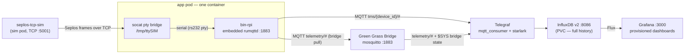

# MQTT visualization stack (Grafana)

A self-contained, locally-runnable stack that answers "what is the battery doing?"
without AWS QuickSight: the repo's own Seplos simulator feeds the **real** `bin-rpi`
adapter, and its MQTT telemetry lands in Grafana dashboards with **full history**
(InfluxDB-backed — time-range queries, not just a live view).

Everything lives under `deploy/` (not to be confused with `distro/deploy/`, the
on-Pi systemd/mosquitto assets). Nothing here touches the shipping Pi or MCU paths.

## Architecture



Design constraints worth knowing before debugging:

- **bin-rpi speaks serial only** (`kind = "rs232" | "rs485"` device paths — no TCP
  transport in `lib-io`), so `socat` materializes a pty bridged to the sim's TCP
  socket. A pty cannot cross a container boundary (the link resolves into that
  container's `/dev/pts`), which is why socat and bin-rpi share one container.
- **`seplos-tcp-sim --listen` serves one connection and exits on disconnect** —
  the sim entrypoint re-listens in a loop, and the sim Deployment deliberately has
  **no probes** (a kubelet TCP probe would consume the single accept slot).
- The embedded rumqttd broker is **plaintext MQTT 3.1.1, no auth, bound to
  0.0.0.0** so Telegraf can subscribe. Demo posture — see [Security caveats](#security-caveats).

## Build the images

One multi-stage Dockerfile (`deploy/docker/Dockerfile`) with two targets, built
for the host arch (amd64 and arm64 both supported via `TARGETARCH`-mapped
static-musl builds; needs BuildKit):

```bash
just viz-images                      # docker (BuildKit) — sentient-viz-{app,sim}:local
just viz_builder=podman viz-images   # podman (adds --ignorefile; no BuildKit)
```

The build deliberately does **not** copy `.cargo/` — that config pins the internal
kellnr mirror (`rust-mirror:8000`), unreachable off the HVD network. Crates
resolve from crates.io; `Cargo.lock` still pins every version.

## Quickstart — compose (no cluster)

The fastest route: `deploy/compose/compose.yaml` is the chart's docker-compose
twin — same six services, same demo credentials, and it mounts the chart's own
dashboard JSONs (single source). Rootless podman works out of the box (no
cgroup delegation needed, unlike a local k3d/kind cluster).

```bash
just viz-up                               # podman-compose by default
just viz_compose="docker compose" viz-up  # docker users
```

<http://localhost:3000> — `admin` / `admin`. InfluxDB: <http://localhost:8086>;
MQTT broker: `localhost:1883` (all loopback-only). Inject faults without kubectl:

```bash
just viz-ctl                        # default line: faults high_voltage_protection
just viz-ctl "state current=-3000"
just viz-ctl "faults none"
```

`just viz-down` stops the stack. The named `influxdb-data` volume keeps the
telemetry history across restarts; `podman volume rm sentient-viz_influxdb-data`
is the full reset.

## Install (Kubernetes)

Load the local images into your cluster, then install the chart:

```bash
# kind
kind load docker-image sentient-viz-app:local sentient-viz-sim:local

# k3s
docker save sentient-viz-app:local sentient-viz-sim:local | sudo k3s ctr images import -

# minikube
minikube image load sentient-viz-app:local sentient-viz-sim:local

just viz-install           # helm upgrade --install into namespace sentient-viz
kubectl -n sentient-viz get pods -w
```

Expected steady state: `sim`, `app`, `greengrass-bridge`, `influxdb`,
`telegraf`, `grafana` all `Running`; the app pod goes `Ready` once rumqttd
binds :1883.

## Open Grafana

```bash
kubectl -n sentient-viz port-forward svc/sentient-viz-grafana 3000:3000
```

<http://localhost:3000> — `admin` / `admin` (demo default). Four dashboards are
provisioned into the **Sentient** folder:

- **Battery Overview** — pack voltage / current / power, SOC gauge + trend,
  min/avg/max temperature, heartbeat liveness, diagnostic-event count.
- **Cell Detail** — 14 cell-voltage traces, latest per-cell SOC, per-cell
  temperatures, and the active-diagnostics table.
- **MQTT Stream** — verbatim tail of every raw MQTT message, message rate by
  topic.
- **Green Grass Bridge** — what would be sent to AWS IoT Greengrass, for
  parity — see [The Green Grass Bridge](#the-green-grass-bridge-greengrass-parity).

Healthy steady-state numbers (the sim's `BatteryState::sample_14_cell()`
fixture): pack ≈ 53 V, current +1.64 A (TMS sign: positive = sourcing into the
microgrid, i.e. discharging — the mapping inverts the vendor's charge-positive
convention), SOC 77.5 %, ≈ 25 °C.
Panels populate within ~30 s of the app pod going Ready (primary telemetry is
non-retained; Telegraf must be subscribed before frames count).

## Inject faults & change battery state

The sim's runtime control protocol is stdin-only, so the sim container feeds its
stdin from a FIFO at `/ctl/sim.ctl` — inject via `kubectl exec` (not
`kubectl attach`, which needs a TTY, is single-client, and drops lines):

```bash
SIM=deploy/sentient-viz-sim
kubectl -n sentient-viz exec $SIM -- sh -c 'echo "faults high_voltage_protection" > /ctl/sim.ctl'
kubectl -n sentient-viz exec $SIM -- sh -c 'echo "state current=-3000" > /ctl/sim.ctl'
kubectl -n sentient-viz exec $SIM -- sh -c 'echo "behavior silence" > /ctl/sim.ctl'   # watch heartbeats drop
kubectl -n sentient-viz exec $SIM -- sh -c 'echo "faults none" > /ctl/sim.ctl'
```

Control grammar (see `docs/seplos-sim.md` for the full reference):
`behavior normal|corrupt-checksum|wrong-address|silence|garbage|truncated:N|rtn-error:CODE`,
`faults name[,name...]|none`, `state sample14|fault-vector|key=value ...`.

Faults are polled every `app.poll.faultEvery` cycles — at chart defaults they
appear on the dashboards within ~20 s, in the **Active diagnostics** table and
the **Diagnostic events** stat. On the compose route, `just viz-ctl "<line>"`
sends the same control lines.

Note: the sim rebuilds its state fresh for each client connection, so injected
faults/behavior/state reset to the `sample_14_cell` baseline whenever the app
reconnects (e.g. an app container restart) — re-inject afterwards.

## The Green Grass Bridge (Greengrass parity)

On a real deployment the on-Pi mosquitto relay (`distro/deploy/mosquitto.conf`)
pulls the `telemetry/#` namespace off the device's embedded broker and — when
`[greengrass]` is configured — pushes it to an AWS IoT Greengrass core over
mTLS. This stack reproduces that pipeline end to end, minus the AWS leg, so
Grafana can show **exactly what would be sent to Greengrass** next to the
device-direct TMS stream:

- The demo `[greengrass]` config section activates `GreengrassTap` in `bin-rpi`,
  which publishes the merged flat legacy JSON (the Greengrass baseline schema)
  to `telemetry/battery/{device_id}` on the embedded broker. The section's
  host/cert values are placeholders — they are only ever read by
  `bin-rpi --emit-mosquitto-bridge`, which this stack never invokes.
- The **greengrass-bridge** service is a mosquitto instance whose only inbound
  data is a bridge `connection device-broker` pulling `telemetry/# in 1` from
  the app — the same topic/QoS the rendered `greengrass-relay` block would
  bridge out. Everything on this broker IS the Greengrass-bound stream.
  (Compose exposes it loopback-only on `localhost:1884` for a debug peek.)
- Telegraf holds a second consumer against the bridge (`telemetry/#` plus the
  bridge's retained `$SYS` connection-state topic) and derives the
  `greengrass_telemetry` / `greengrass_bridge_state` measurements.
- The **Green Grass Bridge** dashboard shows the bridge link state, the
  verbatim Greengrass-bound payloads, typed views, and parity overlays against
  the device-direct TMS measurements (port voltage, current, SOC, cell 0
  voltage — the traces should sit on top of each other, modulo the legacy
  schema's mV/percent units).

## Data model

| MQTT topic | Influx measurement | Fields | Tags |
|---|---|---|---|
| `tms/+/dc_measurement_update` | `dc_measurement` | `line_voltage`, `line_amperage`, `line_power` | `device_id`, `port_number` |
| `tms/+/power_hardware_update` | `battery_pack` | `average/max/min_temperature` | `device_id` |
| `tms/+/power_hardware_update` | `battery_cell` | `voltage`, `state_of_charge` (0–1), `temperature`, `cycle_counter` | `device_id`, `cell_number` |
| `tms/+/active_diagnostic_state` | `diagnostic` | `hint`, `occurrence_count`, `suspect_parameter` | `device_id`, `failure_mode`, `severity` |
| `tms/+/heartbeat` | `heartbeat` | `sequence_number` | `device_id` |
| `telemetry/+/+` (via the bridge) | `greengrass_telemetry` | every numeric key of the flat legacy JSON (`current`, `state_of_charge` %, `cell_{i}_voltage` mV, `temperature_{j}`, fault flags, …) | `device_type`, `device_id` |
| `$SYS/broker/connection/device-broker/state` (bridge-local) | `greengrass_bridge_state` | `connected` (1/0) | `connection` |

Not ingested (deliberately): the retained state topics (`device_info`,
`power_port_state`, `energy_start_stop_state`, …) and `storage_update`.
Timestamps are Telegraf message-arrival time — the TMS payload carries
`{"seconds": …}` objects, indistinguishable from arrival time at a 2 s cadence.

## Security caveats

This is a **demo/simulation stack**, not a production deployment:

- The rumqttd broker is plaintext, unauthenticated, and bound to `0.0.0.0`
  inside the pod network — and the greengrass-bridge mosquitto listener is the
  same demo posture. Set `networkPolicy.enabled=true` to restrict the app broker
  to Telegraf + the bridge, the bridge to Telegraf, and the sim to the app, on
  clusters with a NetworkPolicy-enforcing CNI. (The on-Pi relay this models runs
  listener-less; the open listener exists only so Telegraf can subscribe.)
- Grafana (`admin`/`admin`) and InfluxDB (`sentient-demo-token`) credentials are
  committed demo defaults — override `grafana.adminPassword`,
  `influxdb.adminPassword`, and `influxdb.adminToken` anywhere shared.

## Teardown

```bash
just viz-uninstall
# Full reset (drops the telemetry history):
kubectl -n sentient-viz delete pvc sentient-viz-influxdb
```

## Verifying chart changes

```bash
just viz-lint     # helm lint + helm template render
```

CI runs this stack in two places: every PR renders the chart in all values
variants (`viz-lint` job in `ci.yml`), and every qualifying merge to main
upgrades a **standing deployment** in the `viz-uat` namespace on the CI k3s
cluster — asserting live telemetry + fault injection, then leaving the stack
running as a persistent Grafana demo with full history (`viz-uat` job in
`uat.yml`; advisory — it doesn't gate the release auto-cut). Bring-up,
guardrails, and access: `.ci/k8s/viz-uat/README.md`.
