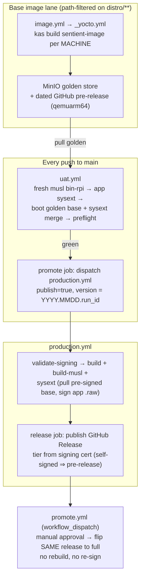

<p class="eyebrow">Sentient METEOR · Deployment · Release Lifecycle</p>

# Release lifecycle & promotion

Every artifact that reaches a device travels one pipeline: a path-filtered **golden base image
builder** (`image.yml`), a post-merge **UAT gate** that boots the real deploy mechanism
(`uat.yml`), a **production build-and-sign lane** (`production.yml`), and a **human-gated
promotion** that flips a blessed candidate to a full release in place (`promote.yml`). The
model is *continuous candidates, deliberate promotion*: every green merge to `main`
auto-cuts a dated, fully-signed **pre-release** candidate; shipping is a separate, explicit,
approval-gated act that reuses the exact bytes UAT validated.



| Workflow | Trigger | Role | Durable output |
|---|---|---|---|
| `image.yml` → `_yocto.yml` | push to `main` filtered on `distro/**`, `.ci/yocto.Dockerfile`, the two workflow files; `workflow_dispatch` | Build the app-free **base** Yocto OS image per MACHINE. Build only — no boot, no tests. | qemuarm64 golden bundle as a dated pre-release (tag `YYYYMMDD.<run_id>`) + fixed MinIO key; CMS-signed shipping `.wic` bases staged to the MinIO golden store |
| `uat.yml` | every push to `main`; `workflow_dispatch` | Boot the golden base with the freshly-built app sysext merged in; preflight + Robot e2e; auto-cut a candidate on green | dispatch of `production.yml` with `publish=true` and a CalVer version |
| `production.yml` | `v*.*.*` tag push, or `workflow_dispatch` (`publish` + `version`) | Build + CMS-sign every artifact; publish the GitHub Release (tier decided by the signing cert) | signed GitHub Release `vYYYY.MMDD.<run_id>` (pre-release on the self-signed tier) |
| `promote.yml` | `workflow_dispatch` (`version`) | Human-gated flip of the SAME candidate release to full — no rebuild, no re-sign | the same release, `prerelease=false`, marked latest |

## 1. Golden base builds — `image.yml`

The Pi OS image is split (post sysext-split) into an immutable **base** and a separately-signed
**app extension**. `image.yml` owns the base: it is path-filtered so the heavy `kas build
sentient-image` runs **only** when the image inputs change — `distro/**` (layers, recipes, kas
manifest), the Yocto builder Dockerfile, or the build workflows themselves. A normal code merge
changes only `bin-rpi`/the app sysext and never rebuilds the base.

`image.yml` delegates to the reusable `_yocto.yml`, which builds per MACHINE and **builds
only** (boot/preflight/e2e all live in `uat.yml`):

| MACHINE | Purpose | Published as |
|---|---|---|
| `qemuarm64` | Emulation golden — the UAT boot target (faithful aarch64 Pi stand-in; bare `raspberrypi5` images are not runqemu-bootable) | Self-contained bootable bundle (`rootfs.ext4` + kernel + `qemuboot.conf` + manifest) as a dated GitHub **pre-release** (tag `YYYYMMDD.<run_id>`), CMS-signed, and staged to the fixed MinIO key `golden/qemuarm64/sentient-image.tar.gz` for fast in-cluster pulls |
| `raspberrypi5` / `raspberrypi4-64` | Shipping bases | CMS-signed `.wic` staged to the MinIO golden store — `production.yml` pulls these pre-signed bases at release time instead of rebuilding |

The golden emulation bundle is signed with the **same** X.509 CMS flow as the shipping `.wic`,
deliberately: the sign → stage → pull → verify chain is exercised on the emulation image every
UAT run before it is trusted for a real release.

## 2. Post-merge UAT — `uat.yml`

Runs on **every push to `main`**. It never rebuilds the base image; it exercises the *real*
production deploy mechanism against the latest golden:

1. **Build the one thing that changed** — the static-musl aarch64 `bin-rpi`
   (`just build-musl aarch64-unknown-linux-musl`), the exact artifact shape the
   `sentient-agent-bin` recipe packages.
2. **Build the app sysext fresh** from the just-merged commit: stage the binary into the
   recipe files dir, `kas build sentient-app-sysext` (qemuarm64) — a small squashfs `.raw`
   carrying only `/usr/bin/bin-rpi` + `extension-release` metadata.
3. **Pull the golden base** from the MinIO golden store (in-cluster; the GitHub pre-release
   stays the durable, browsable copy) and **verify its CMS signature before booting** — the
   same degrade ladder as the signer: CA-verify, fall back to signature-only for the
   self-signed pre-release cert, hard-fail on a tampered bundle.
4. **Merge the sysext in** at the on-device deploy path `/var/lib/extensions/sentient-app.raw`
   (offline via `debugfs` — a writable data path, not a `/usr` mutation), so
   `systemd-sysext.service` merges it into `/usr` at boot exactly as production does.
5. **Preflight boot** under `runqemu`: PASS requires the systemd-sysext merge signal *and*
   `sentient-agent.service` reaching Started (journal forwarded to the captured console; on
   failure the console dump *is* the journalctl).
6. **Robot e2e** — the full Seplos → TMS → MQTT suite against the merged app.
   <span class="pill pill--todo">auto-skips · #156</span> Until the `distro/qemu/*.robot`
   suites land, this step exits with a notice and the preflight remains the live UAT gate;
   it activates the moment a `.robot` suite appears, with no workflow edit.

On green UAT (and only on a real push, never a manual dispatch), the `promote` job in
`uat.yml` **auto-cuts a candidate**: it dispatches `production.yml` with `publish=true` and a
CalVer version `YYYY.MMDD.<run_id>`. A dispatch is used instead of a token-pushed tag because a
tag pushed by `GITHUB_TOKEN` would *not* trigger `production.yml` — `workflow_dispatch` is the
exception that runs under `GITHUB_TOKEN`, and the tag softprops later creates cannot re-trigger
anything, so there is no loop.

## 3. Production build + sign — `production.yml`

Triggered by a real `v*.*.*` tag push or by dispatch. A plain dispatch with `publish=false`
(the default) is a **dry run**: it builds and signs everything but skips the release job.

| Job | Status | What it does |
|---|---|---|
| `validate-signing` | <span class="pill pill--ok">active</span> | Fast `SIGNING_*` preflight via the shared `cms-sign` action (`mode: validate`): sign+verify a throwaway blob in seconds, so a bad secret fails before the hours-long build. Outputs the **tier**: `release` (signer chains to `CA_CRT`) or `prerelease` (valid signature, self-signed cert). |
| `build` | <span class="pill pill--ok">active</span> | `aarch64-unknown-linux-gnu` `bin-rpi` (the contract target), optimized-with-symbols `profiling` profile, built **auditable** (embedded dep list) + CycloneDX SBOM + cargo-audit/cargo-deny evidence. Ships both the stripped binary and the unstripped `.elf`. |
| `build-musl` | <span class="pill pill--ok">active</span> | `aarch64-unknown-linux-musl` static `bin-rpi` — ABI-independent of the Yocto rootfs glibc; the artifact the sysext recipe packages. Static-PIE verification step included. |
| `zephyr` | <span class="pill pill--todo">if: false · #191</span> | Zephyr MCU emulation firmware (`qemu_cortex_a53`, `qemu_cortex_m3`). West-manifest fixes are locally verified, but the job stays gated off until the rebuilt `sentient-zephyr-builder` image is confirmed live and a full run goes green. |
| `sysext` | <span class="pill pill--ok">active</span> | Per shipping MACHINE: `kas build sentient-app-sysext` from this release's musl `bin-rpi`, CMS-sign the emitted `.raw`, and **pull** the pre-signed base `.wic` from the MinIO golden store — the base is never rebuilt here. <span class="pill pill--warn">TODO(verify-at-build)</span> authored from the frozen interface contract; the workflow's own comments flag the first real run as bring-up. |
| `mcu-boot-smoke` | <span class="pill pill--todo">if: false · #191</span> | Renode Cortex-M3 boot-smoke via `_emulation.yml` — MCU-firmware validation, deliberately in the release lane (not Pi UAT). Same builder-image dependency as `zephyr`; re-joins the release `needs:` only after an observed green run. |
| `release` | <span class="pill pill--ok">active</span> | Aggregates all artifacts, CMS-signs the runnable RPi binaries, cosign-signs `SHA256SUMS` (keyless Sigstore bundle, non-fatal), generates git-cliff notes, publishes via softprops, then **hard-verifies** the published release against the required-asset list below. |

Whether the release publishes as a **pre-release** or a **full release** is decided by the
*signing tier*, not by a human: a self-signed signer (e.g. the `CN=example.local` placeholder)
still produces valid signatures but publishes as a GitHub pre-release with a
"(pre-release — self-signed)" banner; a CA-chained signer publishes full.

### The signed artifact set

The release job (and `promote.yml`, independently) refuses an incomplete release. Required
assets, per `production.yml`'s "Verify release published" step:

| Asset | Signature sidecar | Produced by |
|---|---|---|
| `bin-rpi-linux-arm64` (stripped, glibc) | `bin-rpi-linux-arm64.p7s` | `build` + release-job CMS sign |
| `bin-rpi-linux-arm64-musl` (stripped, static) | `bin-rpi-linux-arm64-musl.p7s` | `build-musl` + release-job CMS sign |
| `sentient-image-raspberrypi5.wic.bz2` | `….wic.bz2.p7s` | `_yocto.yml` (pre-signed golden base, pulled from MinIO) |
| `sentient-image-raspberrypi4-64.wic.bz2` | `….wic.bz2.p7s` | `_yocto.yml` (pre-signed golden base, pulled from MinIO) |
| `sentient-app-raspberrypi5.raw` | `….raw.p7s` | `sysext` job (built + signed this release) |
| `sentient-app-raspberrypi4-64.raw` | `….raw.p7s` | `sysext` job (built + signed this release) |
| `SHA256SUMS` | `SHA256SUMS.cosign.bundle` (best-effort) | `release` job |
| `signing-cert.pem`, `ca.pem` | — | attached so any consumer can verify every `.p7s` |

Alongside these ride the unstripped `.elf` symbol files, `.tar.gz` bundles, per-target
CycloneDX SBOMs, and the `sentient-rs.cargo-audit.json` / `sentient-rs.cargo-deny.jsonl`
security-gate evidence.

## 4. Human-gated promotion — `promote.yml`

The final step is deliberately boring: **flip the same release object in place**.

> **You ship precisely the bytes you tested.** Promotion is `gh release edit` on the existing
> candidate — same version, same tag, same body, same signed assets that passed UAT. No
> rebuild (which would produce different bytes than UAT validated) and no re-sign. The
> candidate's tag already exists, so promotion cannot be a tag push — it is an edit of the
> Release object, `prerelease → false`, marked latest.

Mechanics, in order:

1. **Manual approval gate** — `trstringer/manual-approval` (pinned by SHA, v1.13.1) opens an
   approval issue and blocks until a listed approver (`jstandish` or `daverogers1`) comments
   `approved`. GitHub's native environment required-reviewers are Enterprise-only for private
   repos, so an `environment:` gate would be inert here — the action *is* the production-stage
   gate. Self-approval is currently allowed (`exclude-workflow-initiator-as-approver: false`)
   for solo operation; flipping it to `true` enforces a distinct second person.
2. **Sanity** — the release must exist and currently be a pre-release (idempotent; guards
   fat-fingered versions).
3. **Completeness** — the same required-asset check as `production.yml`'s verify step; a
   candidate short a shipping deliverable is refused.
4. **Flip + confirm** — `gh release edit --prerelease=false --latest`, retitled without the
   pre-release banner, then re-read to confirm the flip actually landed.

## 5. The CMS signing chain, end to end

All X.509 signing flows through one composite action, `.github/actions/cms-sign`:

- **`mode: validate`** (the `validate-signing` preflight) — proves `SIGNING_KEY` matches
  `SIGNING_CRT`, CMS-signs a throwaway blob, and classifies the trust **tier**: CA-chained ⇒
  `release`, valid-but-self-signed ⇒ `prerelease`, invalid ⇒ hard fail.
- **`mode: sign`** — detached CMS signature per file (`<file>.p7s`, DER), then a verify with
  the same degrade ladder: CA-verified (notice) → signature-only `-noverify` (warning,
  pre-release tier) → invalid (error, job fails). It always emits `signing-cert.pem` +
  `ca.pem` next to the signatures so any consumer can verify:

```sh
openssl cms -verify -binary -content <file> -in <file>.p7s -inform DER -CAfile ca.pem
```

Where each signature is made and checked:

| Artifact | Signed in | Verified by |
|---|---|---|
| Golden emulation bundle (`sentient-image.tar.gz`) | `_yocto.yml` "Sign golden bundle" | `uat.yml`, **before every boot** — the pipeline's own rehearsal of the shipping chain |
| Shipping base `.wic` | `_yocto.yml` (staged pre-signed to MinIO) | release consumers via `ca.pem`; pulled unmodified by `production.yml` |
| App sysext `.raw` | `production.yml` `sysext` job | release consumers via `ca.pem` |
| Runnable `bin-rpi` binaries | `production.yml` `release` job | **on-device** (direct-deploy path), `distro/deploy/verify-binary.sh` (below) |
| `SHA256SUMS` | cosign keyless (Sigstore bundle), best-effort | `cosign verify-blob --bundle SHA256SUMS.cosign.bundle …` |

### The on-device gate

`distro/deploy/verify-binary.sh` is the tier-1 integrity control **on the direct-deploy path**
(a manually-installed `bin-rpi` on a stock OS, per `distro/deploy/bin-rpi.service`): it pairs
with that unit's `ExecStartPre`, so **a tampered or swapped binary fails verification and the
service never starts**. It runs a detached CMS verify of `<bin>.p7s` against the device's trust
anchor `/etc/sentient/ca.crt` (`-binary`, DER — matching the signer side exactly); any non-zero
exit blocks `ExecStart`. Missing openssl, missing CA, or missing signature each fail closed.

The Yocto image's `sentient-agent.service` deliberately has **no** `ExecStartPre` verify step:
there, the integrity story for the binary is the CMS-signed `.wic` base + the CMS-signed app
sysext `.raw` it arrives in — re-verifying a file already inside a signed, immutable rootfs is
redundant and would pull `openssl` into `core-image-minimal` (size/attack-surface, per the
unit's own note).

<span class="pill pill--warn">scope</span> This chain proves artifacts were not tampered with
between the pipeline and the device — it is **not** on-device verified boot. There is no
dm-verity / secure-boot root of trust yet (`production.yml` marks it a Phase 3 follow-up), and
the Pi's closed VideoCore BootROM is an accepted, documented residual risk.

See [Signing & verification](../security/signing-and-verification.md) for verifier-side commands, and
[Yocto image & OS hardening](distro.md) for the base image the lifecycle ships.
