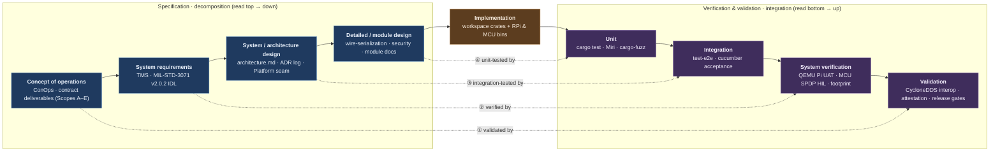

Process · Specification ↔ Verification Traceability

# V-Model alignment

The [systems-engineering **V-Model**](https://en.wikipedia.org/wiki/V-model) reads as two arms
joined at a vertex: the **left arm descends** from concept to implementation (each level *specifies*
and *decomposes* the level below), and the **right arm ascends** from unit test to validation (each
level *integrates* and *verifies* the matching left-arm level). The **horizontal rungs** are the
traceability contract: every specification artifact has a corresponding verification activity at the
same level, and nothing on the left is "done" until its rung on the right is green.

This page maps `sentient-rs`'s **actual** repo artifacts onto that V — every entry cites a real
checked-in doc, test suite, or CI lane. It is deliberately honest about where a rung is **strong**
(the spec is mechanically tied to its verifier) and where it is a **gap** (the spec exists but its
verification is stubbed, host-only, or hardware-gated).

> Two of the left-arm anchors — [`architecture.md`](../architecture.md) and the
> [decision records](../decisions/README.md) — are being rewritten in the same reorg pass by a
> concurrent editor; this page links them but does not restate their content.

## The V

The vertex is **implementation** (the workspace crates + the two platform binaries); the bottom rung
(implementation ↔ unit test) is the tightest, and the top rung (concept ↔ validation) is where the
contract is actually proven or found wanting.

---

## Left arm — specification & decomposition

### L1 · Concept of operations

*What the system is for and what the contract owes.* A Raspberry Pi comms module reads a Seplos BMS
over RS-485, translates telemetry to the TMS (MIL-STD-3071) data model, and publishes it over
MQTT / DDS; a Zephyr-lineage MCU is the second target.

- [`security/README.md`](../security/README.md) — the Scope-E consult framing and honesty note
  (signed boot vs. measured boot).
- [`reports/gap-analysis-meteor-parity.md`](../reports/gap-analysis-meteor-parity.md) — capability
  parity vs. the `meteor-adapter` Python baseline, tracking contract **Scopes A–E**.
- [`reports/audit-2026-07.md`](../reports/audit-2026-07.md) — full-project audit against eight
  dimensions incl. the CI gate → dev → UAT → production shape.
- `KICKOFF.md` (repo root) — the authority for "correctness is measured against the Seplos protocol
  + real captures + the TMS standard, never the Python prototype."

### L2 · System requirements

*The externally-imposed shape the output must match.* The requirements are not prose — they are the
checked-in **IDL** and its coverage catalogue.

- [`compliance/README.md`](../compliance/README.md) — field-by-field TMS schema-shape requirement,
  cited to specific IDL lines.
- [`compliance/tms/mil-std-3071_data_model.idl`](../compliance/tms/mil-std-3071_data_model.idl) — the ground-truth IDL
  (v2.0.2) checked in under `docs/compliance/tms/`; plus `mil-std-3071.pdf` for the timing/QoS tables
  with no IDL representation, and [`compliance/tms/tms-coverage.md`](../compliance/tms/tms-coverage.md)
  (the 37-topic binding catalogue).
- Requirement-shaping decisions: [ADR 0003 — device role STOR](../decisions/0003-tms-device-role-stor.md),
  [ADR 0007 — TPM/TEM naming](../decisions/0007-tpm-tem-naming.md).

### L3 · System / architecture design

*How one codebase serves both targets.*

- [`architecture.md`](../architecture.md) — the end-to-end data pipeline and the dual-target
  trait-seam design (`SerialTransport` / `Publisher` / `Platform`). *(S6-owned this pass.)*
- [`architecture/crate-graph.md`](../architecture/crate-graph.md) + generated `crates.svg`/`crates.mmd`
  — the compile-time layering enforced by `cargo-deny` and the crate-graph gate.
- [Decision records](../decisions/README.md) — the ADR log, notably
  [ADR 0009 — spec-app ports & adapters](../decisions/0009-spec-app-ports-and-adapters.md), which
  defines the `Platform` port (`spec-app`) that keeps `impl-app` hardware-free. *(The ADR log is
  being extended in the concurrent architecture pass.)*

### L4 · Detailed / module design

*Component-level design, memory model, and security integration.*

- [`architecture/wire-serialization.md`](../architecture/wire-serialization.md) — the bespoke flat,
  integer-formatting serializer (no `serde`/`ryu`/`f32`) and the store-canonical / render-on-output
  memory model that fits 64 KB SRAM.
- Security detailed design: [`security/integration-map.md`](../security/integration-map.md),
  [`security/signing-and-verification.md`](../security/signing-and-verification.md),
  [`security/wolfcrypt-backend.md`](../security/wolfcrypt-backend.md),
  [`security/arm-trustzone-deep-dive.md`](../security/arm-trustzone-deep-dive.md).
- Per-crate module design: [`reference/modules/`](../reference/README.md)
  (`lib-parse`, `lib-mapping`, `lib-io`, `lib-mqtt`, `lib-security`, `impl-app`, `bin-rpi`).
- The [performance reports](../perf/rp2350-footprint-perf.md) also feed *back* into design as the
  SRAM/stack budget constraints the module design must respect.

### Vertex · Implementation

The [workspace crates](../reference/README.md) — `lib-canonical`, `lib-tms`, `lib-store`,
`lib-parse`, `lib-io`, `lib-mapping`, `spec-app`, `lib-mqtt`, `lib-net`, `lib-security`, `impl-app`,
`bin-rpi-platform`, `bin-rpi` — plus the MCU firmware (`crates/bin/mcu-rp2350/{ns,s}`, its own excluded
workspace). The RPi binary is the paid deliverable; the MCU is the second target.

---

## Right arm — verification & validation

### R1 · Unit  ↔  L4 detailed design

- **`cargo test`** (`just test`) — per-crate unit + property tests across the pure `no_std` core
  (`lib-parse`, `lib-mapping`, `lib-canonical`, `lib-store`).
- **Miri** (`just miri`, and the nightly [`scheduled.yml`](../../.github/workflows/scheduled.yml)
  `miri` job) — UB / OOB / aliasing / data-race checking on the pointer-arithmetic-heavy parse and
  serialize paths.
- **cargo-fuzz** — targets
  [`crates/test-e2e/fuzz/fuzz_targets/`](../../crates/test-e2e/fuzz/fuzz_targets/) (`fuzz_canonical`,
  `fuzz_parse_command`, `fuzz_parse_telemetry`), run by `just fuzz` and the nightly `scheduled.yml`
  `fuzz` job; the discovered corpus is replayed **on the PR path** by
  [`fuzz_corpus_replay.rs`](../../crates/test-e2e/tests/fuzz_corpus_replay.rs).

### R2 · Integration  ↔  L3 architecture design

- **`test-e2e`** — full-pipeline suites under
  [`crates/test-e2e/tests/`](../../crates/test-e2e/tests/): the poll→map→publish path
  (`mqtt_e2e`, `broker_roundtrip`, `owned_broker_e2e`, `seplos_at_rate_e2e`), behavioral contracts
  (`request_reply_e2e`, `multi_port_e2e`, `sigterm_drain_e2e`), the security surface
  (`tls_stage`, `tls_identity_software`, `token_auth_software`, `broker_auth`), the second protocol
  (`voltronic_inverter_e2e`), and the port-contract check (`spec_conformance_e2e`).
- **`test-acceptance`** — the Cucumber/Gherkin spec-alignment suite
  ([`crates/test-acceptance/tests/features/`](../../crates/test-acceptance/tests/features/):
  `tms_spec_compliance`, `tms_breadth`, `mqtt_spec`, `rtps_spec`, `fault_domains`, `multi_port`,
  `inverter_transform`, `security`, …) driving Seplos → Canonical → TMS field correctness.
- CI lane: [`_test.yml`](../../.github/workflows/_test.yml) (the `logic tests` gate in
  [`ci.yml`](../../.github/workflows/ci.yml)).

### R3 · System verification  ↔  L2 system requirements

- **QEMU Pi UAT** — [`uat.yml`](../../.github/workflows/uat.yml) → `_uat-qemu.yml` builds the
  aarch64-musl `bin-rpi`, merges it as a signed sysext into a `qemuarm64` Yocto image, boots it under
  `runqemu`, and validates agent-start + Robot e2e. Harness doc: [`testing/qemu.md`](../testing/qemu.md).
- **MCU DDS SPDP HIL** — [`testing/mcu-dds-spdp-hil.md`](../testing/mcu-dds-spdp-hil.md): the RP2350
  (`meteor-pico`) joins `ff02::1234` and is discovered by a real Eclipse CycloneDDS stack on the
  same segment. *(TX-only discovery — no user DATA yet; see the gap note.)*
- **Footprint & timing** — [`perf/rp2350-footprint-perf.md`](../perf/rp2350-footprint-perf.md)
  (flash/RAM/stack by measurement) and [`perf/pi-hotpath-benchmark.md`](../perf/pi-hotpath-benchmark.md)
  (real-silicon hot-path soak), driven by the `_bench.yml` lane.

### R4 · Validation  ↔  L1 concept / requirements

- **DDS/RTPS interop (wire-level TMS conformance)** —
  [`dds_interop_e2e.rs`](../../crates/test-e2e/tests/dds_interop_e2e.rs) +
  [`_dds_interop.yml`](../../.github/workflows/_dds_interop.yml): the adapter's TMS DATA is published
  to and read back by a **stock, unmodified CycloneDDS 11.0.1** participant. This is the strongest
  validation rung — it proves the requirement against an independent, certified-lineage DDS stack.
- **Attestation pipeline** — [`compliance/attestation.md`](../compliance/attestation.md): the IDL →
  generated types → coverage catalogue → conftest/Rego gate → **OSCAL 1.2.1 assessment-results**
  chain, gated in CI by [`compliance.yml`](../../.github/workflows/compliance.yml). Conformance is
  machine-generated evidence, not a hand claim.
- **Release gates** — [`production.yml`](../../.github/workflows/production.yml) (sign + publish +
  asset verification) and [`promote.yml`](../../.github/workflows/promote.yml), backed by the
  `_security.yml` and `_supply-chain.yml` SBOM / CVE / semver lanes. Operational framing:
  [`deployment/release-lifecycle.md`](../deployment/release-lifecycle.md).

---

## Horizontal traceability (the rungs)

| Level | Left-arm specification | Right-arm verification | Strength |
|---|---|---|---|
| **①** Concept ↔ Validation | Contract Scopes A–E, ConOps ([gap-analysis](../reports/gap-analysis-meteor-parity.md), [audit](../reports/audit-2026-07.md)) | CycloneDDS interop, [attestation](../compliance/attestation.md) OSCAL evidence, [release gates](../deployment/release-lifecycle.md) | **Strong (RPi) · Gap (MCU)** |
| **②** Requirements ↔ System verification | TMS MIL-STD-3071 IDL, [coverage catalogue](../compliance/tms/tms-coverage.md), [ADR 0003](../decisions/0003-tms-device-role-stor.md) | QEMU Pi UAT ([`testing/qemu.md`](../testing/qemu.md)), MCU SPDP HIL, [footprint](../perf/rp2350-footprint-perf.md) | **Strong (schema/UAT) · Gap (on-target timing)** |
| **③** Architecture ↔ Integration | [`architecture.md`](../architecture.md), [crate graph](../architecture/crate-graph.md), [ADR 0009 seam](../decisions/0009-spec-app-ports-and-adapters.md) | `test-e2e` full-pipeline + `spec_conformance_e2e`, cucumber acceptance | **Strong** |
| **④** Detailed design ↔ Unit | [`wire-serialization`](../architecture/wire-serialization.md), [security integration](../security/integration-map.md), [module docs](../reference/README.md) | `cargo test` + property tests, Miri, cargo-fuzz | **Strong (parse/serialize) · Partial cadence (Miri/fuzz nightly)** |

### Where the V is strong

- **TMS IDL → DDS interop conformance (rung ①/②).** The requirement *is* the checked-in IDL; the
  wire model is **generated** from it (`tms-idl-codegen` → `lib-tms`/`lib-mapping`), and the output is
  validated end-to-end against a **real, unmodified CycloneDDS** participant plus a machine-checked
  OSCAL attestation chain. Spec, implementation, and verifier are mechanically linked — the tightest
  traceability in the repo.
- **Architecture data-pipeline → full-pipeline e2e + cucumber (rung ③).** Every architectural stage
  (Seplos decode → canonical → TMS map → publish) and every behavioral requirement (cadence,
  request/reply within the 0.1 s budget, STOR publications, multi-port fan-out, graceful drain) has a
  named `test-e2e` suite and/or a Gherkin feature exercising the **real binary** over a **real pty**.
- **Defensive parsing → fuzz + Miri (rung ④).** The most memory-dangerous code (frame parsing,
  flat-wire serialization) is the most heavily verified — property tests, three fuzz targets with
  corpus replay on the PR path, and Miri for UB.

### Where the V has gaps (honest coverage)

- **On-target MCU timing is HIL-gated (rung ②).** Footprint and per-reading CPU cost are measured,
  but the *on-target* numbers — poll period, pubs/sec, DDS cadence, `picotool` flash usage — remain
  **not measured on hardware**: the perf report's Performance § documents that the bench
  (`sentient-pi-bench`) has no `picotool`, the board is SWD-only (not USB-enumerated), and SWD/GPIO
  needs passwordless sudo it doesn't have. The right-arm rung for MCU timing is a **documented
  procedure, not a green result**.
- **MCU DATA-path conformance is unproven (rung ①/②).** The MCU SPDP HIL proves **discovery only**
  (TX-only participant announcement); TMS **DATA** over RTPS *from the MCU* is not yet verified. The
  strong CycloneDDS interop above covers the **RPi** DATA path — the MCU inherits the shared `no_std`
  encoders but has no equivalent on-target DATA verification yet.
- **No MCU release/CI lane (rung ①).** [`production.yml`](../../.github/workflows/production.yml)
  records that the Renode boot-smoke and Zephyr emulation lanes were retired with the Embassy pivot
  and that `bin/mcu-rp2350` **has no release-lane presence yet** — so the MCU's right arm above unit/host
  is thin by design, pending a follow-on story.
- **Scope D (legacy Greengrass) fails validation despite passing integration (rung ①).** The
  renderer and `legacy_greengrass_e2e.rs` exercise the mapping, but the gap-analysis and audit both
  find the runtime dispatch arm (`HostTap::Greengrass`) is a **no-op stub** — `legacy/#` never
  publishes in the shipped binary. A green integration test does **not** discharge the concept-level
  requirement here; both reports carry the **NOT MET** verdict.
- **Meshtastic forwarding is provisional (rung ④).** `lib-mesh` exists and is wired, but the protobuf
  framing is self-flagged **PROVISIONAL/unverified against real hardware**, and fault forwarding is
  missing — a partial rung, per the gap-analysis.
- **Deep verification runs nightly, not per-PR (rung ④ cadence).** Miri and cargo-fuzz live in
  [`scheduled.yml`](../../.github/workflows/scheduled.yml); only the fuzz-**corpus replay** is on the
  PR gate. UB/fuzz regressions are therefore caught at day granularity, not per commit.

### Reading the V for a change

When you touch the left arm, walk down to its rung on the right and confirm the verifier is still
green: a TMS shape change re-runs codegen + `dds_interop_e2e` + the attestation gate (rung ①/②); an
architecture/seam change re-runs `test-e2e` + `spec_conformance_e2e` (rung ③); a parse/serialize
change re-runs unit + fuzz + Miri (rung ④). A left-arm change with no green rung on the right is, by
this model, **unverified** — and the gaps above are exactly those un-closed rungs, stated plainly.
